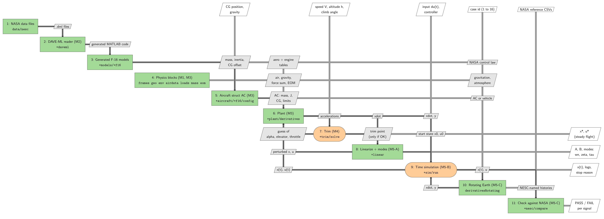
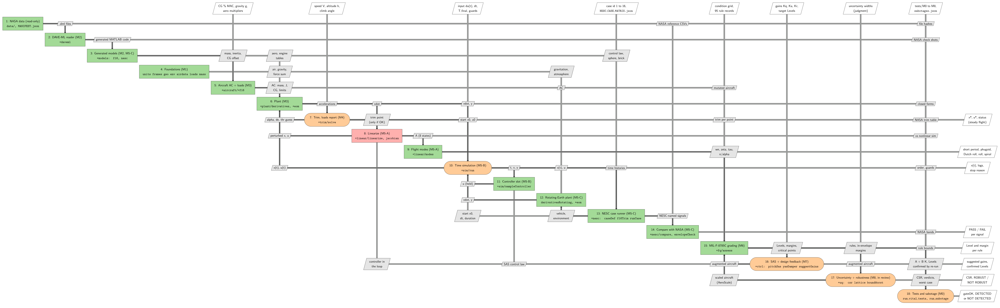
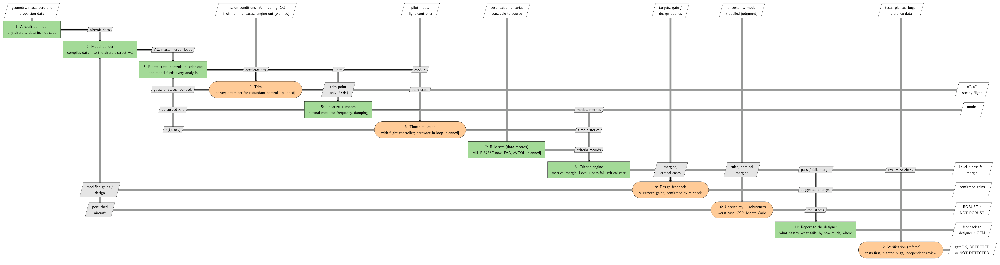
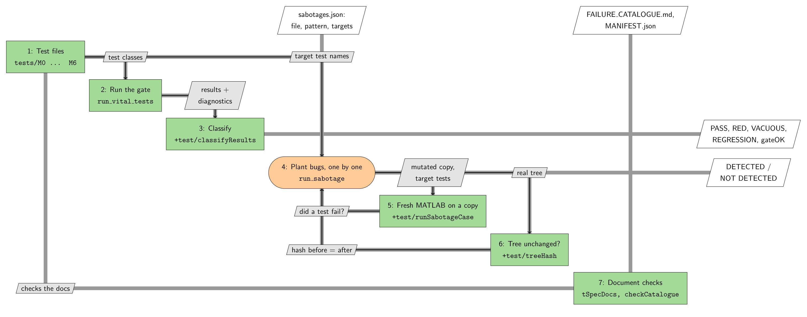
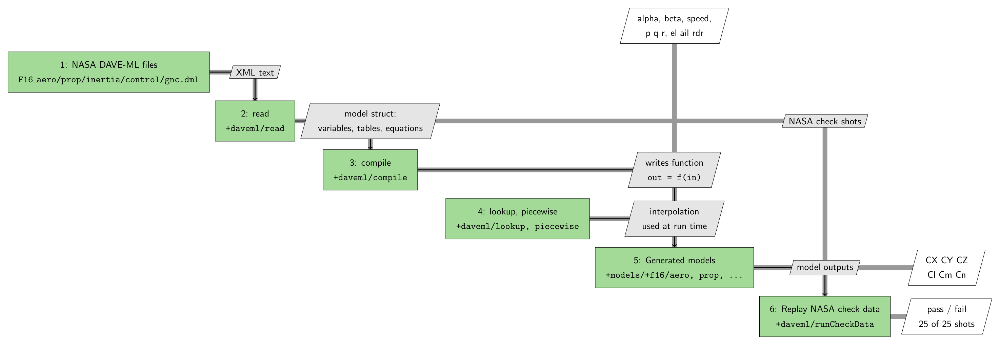
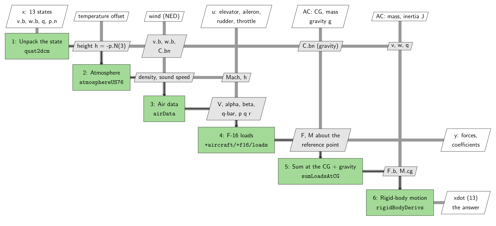
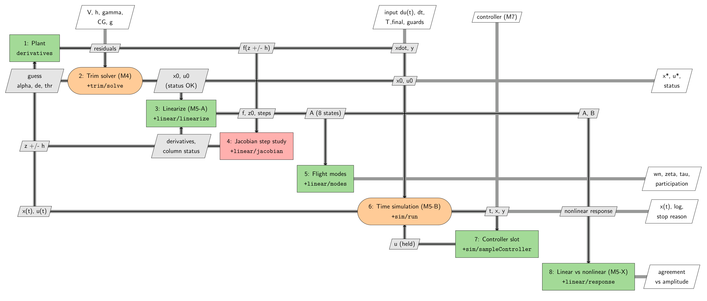
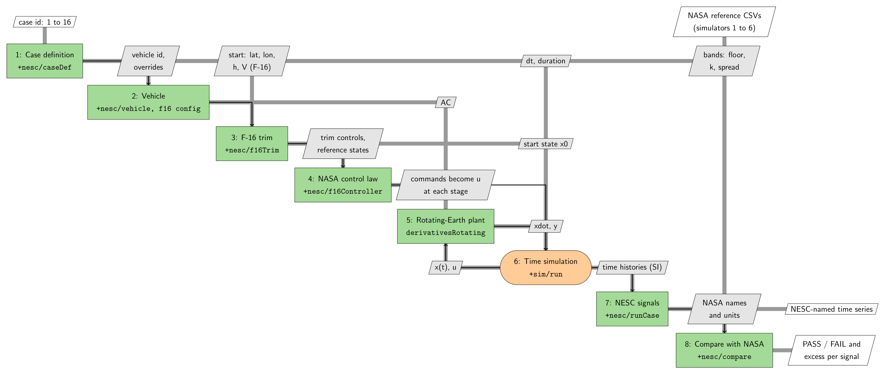

# VITAL framework guide, milestones M0 to M7

This guide explains what is in `C:\VITAL`, what every part does, and how the parts work together. You do not need to know anything about flight simulation to follow it. Read it top to bottom once; later use it as a reference.

The seven diagrams in `docs/xdsm/` are referred to throughout. They are regenerated with `python docs/xdsm/vital_xdsm.py`.

---

## 1. What VITAL is, in plain words

VITAL (Virtual Test and Analysis Lab) is a computer model of one aircraft, the NASA/NESC F-16, together with the machinery to ask that model questions and to prove the answers are trustworthy.

An aircraft in flight obeys one rule: **forces and moments make it accelerate**. If you know the aircraft's state (where it is, how fast, which way it points, how fast it spins) and the pilot's controls (elevator, aileron, rudder, throttle), the air and gravity push on it, and Newton's laws tell you how the state changes in the next instant. VITAL computes that. Everything else is built on top of that one calculation.

From it, VITAL can answer six kinds of question:

| Question | Name | Answer you get |
|---|---|---|
| "What controls hold the aircraft in steady flight at this speed and altitude?" | **Trim** | angle of attack, elevator, throttle |
| "If I nudge the aircraft slightly, how does it respond?" | **Linearization and modes** | the aircraft's natural motions: frequency, damping, time constants |
| "What happens over the next 10 seconds if I move the stick?" | **Simulation** | time histories of everything |
| "Does my model agree with NASA's own simulators?" | **Check against NASA** | pass or fail for each signal |
| "Are the aircraft's motions good enough for a pilot?" | **Flying-qualities grading** | a MIL-F-8785C Level (1 to 3) per requirement |
| "What feedback gains would fix the weak ones?" | **Stability augmentation and design feedback** | suggested gains, confirmed by re-grading |

The second half of VITAL is just as important as the first: **proof**. Every piece was written *after* tests that failed, then tested again, then attacked with deliberate bugs to prove the tests can notice mistakes. A number from VITAL is only believed if it has passed through that process.

### Why the building blocks are called "milestones" (M0, M1, ...)

The **M** stands for **milestone**. Each milestone is one layer. A layer is only allowed to rely on the layers below it, and only after every one of its tests passes and every deliberately planted bug is caught.

| Milestone | One-line meaning | Plain-language role |
|---|---|---|
| **M0** | Test machinery | the referee: runs tests and checks the tests themselves |
| **M1** | Foundations | the bricks: rotations, Earth, air, forces, mass |
| **M2** | NASA data import | reading NASA's F-16 files and turning them into MATLAB functions |
| **M3** | Plant | "given the state and controls, what is the acceleration?" |
| **M4** | Trim | finding steady flight; showing the forces and moments |
| **M5** | Dynamics | linearization, flight modes, time simulation, rotating-Earth check against NASA |
| **M6** | Flying qualities | grading the aircraft's motions against MIL-F-8785C: a Level per requirement |
| **M7** | Stability augmentation | feedback control laws, and VITAL suggesting the gains that fix weak grades |
| M8, M9 | later layers | uncertainty (built, under review); Simulink and Cesium (not covered here) |

---

## 2. Words you will meet (glossary)

| Word | Meaning |
|---|---|
| **State, x** | everything needed to describe the aircraft right now: velocity, spin rates, attitude, position. VITAL's flat-Earth state has 13 numbers. |
| **Controls, u** | the four pilot inputs: elevator, aileron, rudder, throttle. |
| **xdot** | how fast each state number is changing (the "derivative"). The whole framework revolves around computing xdot from (x, u). |
| **Plant** | the function that does that: `xdot = f(x, u)`. Engineers call the thing being controlled "the plant". |
| **Body axes** | a coordinate system fixed to the aircraft: x out the nose, y out the right wing, z out the belly. |
| **NED** | North-East-Down: a coordinate system fixed to the ground below the aircraft. |
| **Angle of attack (alpha)** | the angle between the wing and the oncoming air, measured in the vertical plane. Sideslip (beta) is the sideways equivalent. |
| **Quaternion** | four numbers that describe the aircraft's attitude without the singularities of pitch, roll and yaw angles. VITAL integrates quaternions and converts to angles only for display. |
| **CG** | center of gravity. NASA's F-16 sits at 25% of the mean wing chord (25% MAC). |
| **MAC** | mean aerodynamic chord: a reference wing length (11.32 ft for this F-16). |
| **Trim** | a state where all accelerations are zero: steady flight. |
| **Residual** | how far a candidate trim is from zero acceleration. A good trim has residual about 1e-16. |
| **Linearization** | replacing the curved physics near a trim by straight-line physics: two matrices **A** (how states affect each other) and **B** (how controls affect states). |
| **Eigenvalue** | a number from matrix A that describes one natural motion: how fast it oscillates and how quickly it dies out or grows. |
| **Mode** | one natural motion of the aircraft. Five classic ones: **short period** (fast nose bobbing), **phugoid** (slow climb and dive exchange of speed and height), **Dutch roll** (yaw-roll wobble), **roll** (how fast the roll rate settles), **spiral** (slow drift in bank). |
| **Damping (zeta)** | how quickly an oscillation dies out. 0 = never, 1 = no oscillation at all. |
| **DAVE-ML** | an XML file format for aircraft models. NASA's F-16 aerodynamics, engine and mass are published in it. |
| **NESC** | NASA Engineering and Safety Center. Its check-case package (NASA/TM-2015-218675) gives exact flights that six independent simulators reproduced, so you can check your own simulator against them. |
| **MIL-F-8785C** | the U.S. military flying-qualities specification. VITAL grades aircraft against it in M6. |
| **Level** | MIL-F-8785C's grade for one requirement: 1 = clearly adequate, 2 = adequate with more workload, 3 = controllable but with excessive workload. VITAL uses 4 for "worse than Level 3". |
| **Margin** | how far a value sits from its rule boundary, normalized; positive means the boundary is met. |
| **Critical condition** | the flight condition where a requirement has its worst grade or smallest margin. |
| **CAP** | control anticipation parameter: the short-period frequency squared divided by n/alpha (load factor per unit angle of attack). It measures how the first pitch response relates to the final g. |
| **SAS** | stability augmentation system: a feedback law that moves the control surfaces to add damping or stiffness. |
| **Gain** | the multiplier in a feedback law, e.g. degrees of elevator per degree per second of pitch rate. |
| **Closed loop** | the aircraft together with its feedback law; its A matrix is A + B K. |
| **Test, gate** | a **test** checks one fact. A **gate** is the full list of tests up to a milestone; it passes only if every test passes. |
| **RED / GREEN** | RED = a new test that fails because the feature does not exist yet (expected, and proves the test can fail). GREEN = every test passes. |
| **Sabotage** | a deliberate bug planted in a *copy* of the code to prove that some test catches it. |
| **Evidence tag** | every numeric check says where its expected value comes from: **PUB** (a published value), **INDEP** (an independent implementation, for example MATLAB's Aerospace Toolbox), **ANALYTIC** (a closed-form answer worked out in the test), **REG** (a value registered before the run, not independently confirmed). |

---

## 3. Folder map

| Path | What it is |
|---|---|
| `C:\VITAL\` (root) | the user-facing scripts: `startup_vital.m`, `run_vital_tests.m`, `run_sabotage.m`, `run_f16_trim.m`, `run_f16_loads.m`, `run_f16_modes.m`, `run_f16_sim.m`, `run_nesc_case.m`, `run_axis_checks.m`, `run_f16_fq.m` (M6), `run_f16_sas.m` (M7), `run_f16_uq.m` (M8, under review) |
| `+vital\` | the framework code. A folder starting with `+` is a MATLAB *package*: `+vital\+frames\dcm321.m` is called `vital.frames.dcm321`. |
| `tests\M0` ... `tests\M8` | the tests, one folder per milestone |
| `tests\fixtures\` | deliberately broken or synthetic files used only to test the test machinery itself |
| `docs\` | the specification documents (see section 13) |
| `docs\xdsm\` | the seven diagrams and the script that draws them |
| `data\nesc\original`, `data\mil\original` | NASA's published package and the MIL standard PDF. Read-only; each file's SHA-256 hash is recorded in `data\MANIFEST.json` so tampering is detected. |
| `data\nesc\extracted\` | the same NASA package unzipped: the DAVE-ML models and the reference time histories |
| `rules\` | the MIL-F-8785C rule records, condition grids and coverage table (M6) |
| `uq\` | the uncertainty specification (M8) |
| `reports\` | every test and sabotage report; the changelog; the grading (`fq`), gain-suggestion (`ctrl`) and uncertainty (`uq`) reports; the reviews; and the per-agent work folders |

---

## 4. The big picture: Figure 0



**How to read this and every XDSM figure.** Each box is a computation. The number in the box matches the numbered descriptions in this guide. Boxes sit on the diagonal. Grey lines carry data: a label tells you *what* travels along the line. A line leaving a box runs along its row; a line entering a box comes down its column. Lines below the diagonal that go back to an earlier box are **loops**: a solver guessing, calling the plant, and guessing again. Arrows entering from the top are inputs you supply; arrows leaving to the right are the results you receive. Green boxes are ordinary functions; orange rounded boxes are solvers that iterate.

**The story of Figure 0, in one pass:**

1. NASA's data files (box 1) are parsed (box 2) and written out as MATLAB functions (box 3): the F-16's aerodynamic tables, engine tables, mass and inertia, and NASA's control law.
2. The physics blocks (box 4) and the aircraft struct `AC` (box 5) are the other ingredients the plant (box 6) needs: air, gravity, mass, CG.
3. The plant (box 6) is the one calculation everything else uses: it turns (x, u) into xdot.
4. **Trim** (box 7) calls the plant over and over, adjusting three numbers until acceleration is zero.
5. **Linearize + modes** (box 8) starts from a trim, perturbs the plant slightly in 16 directions to build the A and B matrices, and finds the natural motions.
6. **Time simulation** (box 9) starts from a trim and steps the plant forward in time.
7. **Rotating Earth** (box 10) is a second plant, for NASA's check flights, which include the rotation of the Earth. The simulation (box 9) drives it too.
8. **Check against NASA** (box 11) compares the time histories with NASA's six simulators and says pass or fail for each signal.

### The full system on one page: Figure 6



This is the complete framework, M0 to M8 (M8 still under review), in one diagram. It is specific to the NASA F-16 and the NESC check cases. For the general, aircraft-agnostic layout, see Figure 7 below. It is wide (about 7,600 pixels); open `docs/xdsm/fig_6_full_system.pdf`, which is vector and zooms without blurring. Figure 0 is the simplified version; Figures 1 to 5 zoom into one part each.

| Box | What it is | Milestone | Files |
|---|---|---|---|
| 1 | NASA's published data, read-only and hash-checked | M0, M2 | `data\`, `MANIFEST.json` |
| 2 | reads NASA's XML and writes MATLAB code | M2 | `+daveml` |
| 3 | the generated F-16, sphere and brick models | M2, M5-C | `+models` |
| 4 | the physics bricks | M1 | `+units +frames +geo +env +airdata +loads +mass` |
| 5 | the aircraft struct AC and its force function | M3 | `+aircraft\+f16` |
| 6 | the plant: state and controls in, xdot out | M3 | `+plant\derivatives`, `+eom` |
| 7 | trim and the force breakdown | M4 | `+trim`, `trimLevel`, `loadsReport` |
| 8 | linear model A and B by step-study derivatives | M5-A | `+linear\linearize`, `jacobian` |
| 9 | flight modes | M5-A | `+linear\modes` |
| 10 | time simulation with guards | M5-B | `+sim\run` |
| 11 | the controller slot | M5-B | `+sim\sampleController` |
| 12 | the rotating-Earth plant | M5-C | `derivativesRotating`, `+eom` |
| 13 | runs one NASA case | M5-C | `+nesc` |
| 14 | compares with NASA's six simulators | M5-C | `+nesc\compare`, `envelopeCheck` |
| 15 | MIL-F-8785C grading | M6 | `+fq` |
| 16 | stability augmentation and design feedback | M7 | `+ctrl` |
| 17 | runs the tests and plants the bugs | M0 | `run_vital_tests`, `run_sabotage` |

### The general layout: Figure 7



This is the layout of the framework for **any aircraft and any rule set**, not tied to the F-16. Open `docs/xdsm/fig_7_general.pdf` to zoom. Everything that is aircraft-specific enters as **data** at the top (the aircraft definition, the mission conditions, the certification criteria); the boxes themselves do not change.

| Box | What it is | Status |
|---|---|---|
| 1 | aircraft definition: geometry, mass, aero and propulsion data | built (NASA DAVE-ML for the F-16) |
| 2 | model builder: compiles the data into the aircraft struct AC | built |
| 3 | the plant: one model feeds every analysis | built |
| 4 | trim (a solver; an optimizer once an aircraft has more controls than equations) | solver built; optimizer trim planned |
| 5 | linearization and flight modes | built |
| 6 | time simulation, with a flight controller | built; hardware-in-the-loop planned |
| 7 | rule sets as data records | MIL-F-8785C built; FAA and eVTOL criteria planned |
| 8 | criteria engine: metrics, margin, Level or pass/fail, critical case | built |
| 9 | design feedback: suggested gains, confirmed by re-check | built (gains); design changes planned |
| 10 | uncertainty and robustness | built, under review (M8) |
| 11 | report to the designer: what passes, what fails, by how much, and where | built as reports; a unified report is planned |
| 12 | verification: tests first, planted bugs, independent review | built |

Off-nominal cases (engine or propulsor out) enter at the trim box as extra scenarios; they are planned, not built.

How to find the story in it:

- **The main chain** runs down the diagonal: NASA data (1) to the reader (2) to the models (3) to the aircraft (5) to the plant (6) to trim (7).
- **Every analysis loops with the plant.** Trim (7), linearize (8), simulate (10) and the rotating-Earth plant (12) each send a state to a plant and get xdot back. Those are the loops below the diagonal.
- **The design loop (boxes 15 and 16).** M7 hands an augmented aircraft to the M6 grading, gets Levels and margins back, and adjusts the gains. It also gives its control law to the simulator's controller slot (box 11) and puts the controller inside the linearization (box 8).
- **Box 17 is the referee.** Every box feeds one thing to it in the rightmost column: file hashes from box 1, NASA's check shots from box 2, closed forms from box 6, NASA's trim table from box 7, the linear-vs-nonlinear check from box 8, order and guards from box 10, NASA's bands from box 14, rule bounds from box 15, and the closed-loop checks from box 16.
- **Results arrive on the right:** the trim, the five flight modes, the time histories, pass or fail per NASA signal, the Level per rule, the suggested gains, and the gate verdict.

---

## 5. M0: the test machinery (the referee)

**What it is.** Before any physics, the project built the tools that decide whether physics code is trustworthy. M0 contains no flight physics at all.

**Files and what each does**

| File | What it is |
|---|---|
| `startup_vital.m` | adds VITAL to the MATLAB path and prints the version. |
| `run_vital_tests.m` | runs the gate for a milestone: every test tagged M0 up to Mk. Options let one increment be tested without being broken by another's unfinished work. It also **fails the gate if a test file silently fails to load**. |
| `run_sabotage.m` | the planted-bug check: for each registered sabotage, runs the targeted tests in a separate MATLAB process on a temporary copy of the code and requires them to fail. It also proves the real tree was not altered. |
| `+vital\version.m`, `paths.m` | the version string; the absolute folder locations. |
| `+vital\notImplemented.m` | what every unwritten function calls. It raises the one error `vital:notImplemented`, which marks a test as "RED for the right reason". |
| `+vital\+test\VitalTestCase.m` | the base class of every test. Its checks (`verifyTol`, `verifyWithin`, `verifyExact`) refuse NaN, refuse mixing absolute and relative tolerance, and record every check with its expected value, tolerance and evidence tag. |
| `+vital\+test\provenance.m` | the in-memory log of all those checks, written to JSON. |
| `+vital\+test\classifyResults.m` | sorts every result into PASS, RED-expected, RED-unexpected, RED-suspicious, VACUOUS (a new test that passes before its feature exists), or REGRESSION (an older test broke). It reads error *identifiers*, never message text. |
| `+vital\+test\selectMilestone.m`, `milestoneNumber.m` | choose the tests up to milestone k ("M1" never matches "M10"). |
| `+vital\+test\findExcludedTestFiles.m` | finds test files that matlab.unittest silently dropped. |
| `+vital\+test\loadSabotages.m`, `loadSabotageSet.m`, `applySabotage.m`, `runSabotageCase.m`, `runTargetsToFile.m`, `removeTree.m`, `treeHash.m` | the planted-bug machinery: load definitions, apply one to a copy, run its targets in a child MATLAB, and hash the real tree before and after. |
| `+vital\+io\validateRule.m`, `sampleRule.m` | the schema check for rule records (used from M6). |
| `+vital\+io\readFailureCatalogue.m`, `splitTestRef.m`, `checkCatalogue.m` | read `docs\FAILURE_CATALOGUE.md` and check each failure mode points at a real test. |
| `+vital\+io\sha256File.m`, `requireDeliverable.m` | file hashes for `MANIFEST.json`; a missing document counts as "not implemented". |

**Tests (50):** `tRunnerClassification` (the RED/GREEN logic), `tVitalTestCase`, `tSabotageHarness`, `tSpecDocs` (documents exist and agree), `tCatalogueRules`. Also tagged M1 but part of this machinery: `tRunnerIntegrity` (4) and `tRunnerIncrements` (9).

**How it combines (Figure 5).** Test files go into `run_vital_tests`, which hands the results to `classifyResults`; the output is PASS, RED, VACUOUS or REGRESSION and one yes/no `gateOK`. Separately, `run_sabotage` plants each registered bug in a copy, runs the targeted tests in a fresh MATLAB, and reports DETECTED or NOT DETECTED; `treeHash` proves your real files were never touched.



**What it feeds.** Every later milestone is built on this. M0 produces no number about an aircraft; it produces *trust* in the numbers that come later.

---

## 6. M1: the foundations (the bricks)

**What it is.** The small, general physics pieces every aircraft needs. None of them knows about the F-16. Each is checked against an independent implementation (usually MATLAB's Aerospace Toolbox) or a closed-form answer.

**Files and what each does**

| Package and file | What it does |
|---|---|
| `+units\constants` | exact conversion factors: feet to metres, slugs to kilograms, lbf to newtons. VITAL calculates in SI and converts only at the edges. |
| `+frames\dcm321` | the rotation matrix for yaw-pitch-roll angles (the "direction cosine matrix" taking NED axes to body axes). |
| `+frames\eul2quat`, `quat2dcm`, `dcm2quat`, `dcm2eul`, `quatNormalize` | convert between Euler angles, quaternions and rotation matrices; warn if a quaternion is not unit length; refuse a zero quaternion. |
| `+frames\stationToBody`, `inertiaStationToBody` | NASA publishes positions with x aft and z up; these convert them to VITAL's body axes (x forward, z down). |
| `+geo\constants` | the Earth model numbers from NASA's report (WGS-84 shape, gravity constant, J2, rotation rate). |
| `+geo\lla2ecef`, `ecef2lla` | latitude/longitude/height to Earth-centred Cartesian coordinates and back. |
| `+geo\dcmEcefToNed` | the rotation from Earth-centred axes to the local North-East-Down axes. |
| `+geo\gravitation`, `localGravitation` | gravity from Earth's mass including its flattening (the J2 term). |
| `+geo\levelFlightGravity` | the effective downward acceleration for steady level flight over a rotating Earth; includes Coriolis and curvature terms (built in M4). |
| `+env\atmosphereUS76`, `geometricToGeopotential` | the U.S. Standard Atmosphere 1976: temperature, pressure, density, speed of sound at any altitude. An altitude outside the model's range is an **error**, never a silent clamp. |
| `+airdata\airData` | from velocity and wind: true airspeed V, angle of attack, sideslip, dynamic pressure q-bar, Mach. |
| `+airdata\tasToCasEas`, `vaneAngles` | calibrated/equivalent airspeed; the angles a vane on a boom would sense. |
| `+loads\transferLoad`, `sumLoadsAtCG` | move a force and moment from one point to another; add everything up at the CG, with gravity. |
| `+mass\inertiaTensor`, `massProps` | build the 3x3 inertia matrix; combine several masses into one total mass, CG and inertia. Rejects physically impossible inertias. |
| `+validate\finite` | rejects NaN or Inf anywhere with the error `vital:badInput`. |
| `+verify\envelopeCheck` | the NASA comparison rule: VITAL passes if it lies within the range spanned by NASA's simulators, plus a pre-registered tolerance. |
| `+io\readNescCsv` | reads one of NASA's reference time histories. |

**Tests (93 in total with the machinery tests above):** `tFrames`, `tGeo`, `tLoads`, `tMass`, `tAtmosphere`, `tAirData`, `tEnvelopeCheck`, and `tM1FailureModes` (20 tests, each one asserting an exact error identifier for a bad input). Sabotages included a flipped cross-product in `transferLoad`, a swapped Euler order and geometric instead of geopotential altitude.

**How it combines.** Think of M1 as a toolbox. Nothing here produces an aircraft result by itself. The M3 plant (Figure 2) calls these functions in sequence: unpack the quaternion (`quat2dcm`), find density (`atmosphereUS76`), get air data (`airData`), sum the loads (`sumLoadsAtCG`).

**What it feeds.** M3 (the plant), M4 (trim gravity), M5-C (the rotating-Earth plant uses `geo`, `env`, `frames`).

---

## 7. M2: reading NASA's F-16 files

**What it is.** NASA's F-16 model is published as XML files full of tables and equations. M2 turns them into fast MATLAB functions and proves the conversion is exact.



**Files and what each does**

| File | What it does |
|---|---|
| `+daveml\read` | parses a DAVE-ML file into a MATLAB struct: variables, tables with their breakpoints, and the MathML equations. Refuses malformed files with specific errors (missing units, non-increasing breakpoints, unknown elements, truncated XML). |
| `+daveml\compile` | writes a self-contained MATLAB function `out = f(in)` for the whole model. |
| `+daveml\lookup`, `piecewise` | the run-time pieces the generated code calls: multilinear table interpolation (clamping outside the data, as NASA specifies) and the MathML "if-then-otherwise". |
| `+daveml\runCheckData` | replays NASA's own check cases embedded in the file and compares outputs to NASA's published values. |
| `+aircraft\+f16\generateModels` | the script that runs the above on NASA's five F-16 files. |
| `+models\+f16\aero`, `prop`, `inertia` | **generated, never edited**: the F-16 aerodynamic coefficients (CX, CY, CZ, Cl, Cm, Cn), the engine thrust, and the mass and inertia. |
| `+models\+f16\control`, `gnc` | generated later in M5-C: NASA's control law and its circumnavigation variant. |
| `+models\+nesc\brick_*`, `cannonball_*` | NASA's simple sphere and brick models, generated in M5-C. |

**Tests (29):** `tDavemlParser`, `tDavemlOperators` (every math operator against a hand-computed value), `tDavemlTables` (table storage order and clamping), `tF16CheckData`, `tDavemlFailures`. The headline test: **all 25 of NASA's embedded check points (16 aerodynamic, 9 engine) are reproduced to NASA's tolerances.**

**Two NASA quirks found along the way.** NASA wraps one `piecewise` in an operator-less `apply`, which a strict MathML reader rejects. NASA stores table data with the *last* breakpoint varying fastest, which is easy to reverse and still looks plausible. Both have tests.

**How it combines.** `read` produces a model struct; `compile` turns it into a function that calls `lookup`; `runCheckData` replays NASA's answers through that function and confirms they match.

**What it feeds.** M3: the F-16 plant calls `models.f16.aero` and `prop` for forces; the mass and CG come from `models.f16.inertia`. M5-C: `control` and `gnc` become the autopilot.

---

## 8. M3: the plant (the heart)

**What it is.** The single function that answers "given the state and controls, how is the state changing?" Trim, linearization and simulation all call it.



**Files and what each does**

| File | What it does |
|---|---|
| `+aircraft\+f16\config` | builds the aircraft struct **AC**: reference area, span, chord, mass, inertia, CG position, control limits, and the function that gives the aircraft's forces. Takes CG in % MAC. NASA gives aerodynamic moments about a point at 35% MAC; the CG is at 25%, so the reference points differ and `config` records both. |
| `+aircraft\+f16\loads` | converts SI to NASA's units (feet, degrees) **only at this boundary**, calls `models.f16.aero` and `prop`, and returns forces and moments about the geometry reference point. |
| `+eom\rigidBodyDerivs` | the flat-Earth rigid-body equations: acceleration = F/m minus the turning terms; angular acceleration from the inertia tensor; quaternion rate; position rate. |
| `+plant\derivatives` | the plant itself. Calls, in order: unpack the quaternion; atmosphere; air data; the aircraft's loads; sum at the CG with gravity; rigid-body equations. Returns `xdot` and a struct of diagnostics `y` (V, alpha, beta, Mach, forces, load factor, and whether any table lookup had to be clamped). |

**The numbers the plant takes and returns**

| Name | Contents |
|---|---|
| `x` (13) | body velocity (3), body rotation rates (3), attitude quaternion (4), NED position (3) |
| `u` (4) | elevator, aileron, rudder (rad), throttle (0 to 1) |
| `xdot` (13) | the rate of change of each state |
| `y` | alpha, beta, V, Mach, q-bar, h, forces, moments, load factor `nz`, `outOfEnvelope`, and more |

**Tests (19):** `tF16Plant` (control directions, unit conversion, moving the reference point must not change the answer, the CG moves the pitching moment the right way, bad inputs refused) and `tRigidBody` (torque-free spinning body conserves energy and angular momentum).

**How it combines (Figure 2).** The state is unpacked; the height gives the atmosphere; the atmosphere and velocity give air data; air data and controls give the F-16's forces; forces are moved to the CG and gravity is added; the rigid-body equations produce xdot.

**What it feeds.** M4 (trim), M5-A (linearization), M5-B (simulation).

---

## 9. M4: trim, and the force breakdown

**What it is.** Finding steady flight: the angle of attack, elevator and throttle at which nothing accelerates.

**Files and what each does**

| File | What it does |
|---|---|
| `+trim\solve` | adjusts three unknowns (alpha, elevator, throttle) until three residuals (u-dot, w-dot, q-dot) are zero, using `lsqnonlin` with several starting points. It refuses to call a result a trim unless it really is one: **OK**, **INFEASIBLE** (a variable sits on its limit, for example stall-limited at low speed), **NOT_CONVERGED**, **OUT_OF_DATA_ENVELOPE** (needed a clamped table), or **ERROR**. Only OK may be used. |
| `+aircraft\+f16\trimLevel` | the friendly wrapper: takes speed (ft/s), altitude (ft), CG, g and flight-path angle; returns pitch, alpha, elevator, throttle, Mach and thrust. |
| `+aircraft\+f16\loadsReport` | the force and moment breakdown: aero, thrust, gravity and total, in body axes; also lift, drag and side force. Can evaluate a state you choose, labelled "not a trim". |
| `+geo\levelFlightGravity` | the rotating-Earth correction that makes the flat-Earth trim match NASA's rotating-Earth value. |
| `run_f16_trim.m`, `run_f16_loads.m` | the commands you type. |

**Tests (26):** `tF16Trim` compares against NASA's published trim table (NASA README Table 11) and against NESC case 11; `tF16LoadsReport`; `tLevelFlightGravity`.

**Result.** At 565.7 ft/s and 10,013 ft: pitch 2.6542 degrees, elevator -3.2412 degrees, throttle 13.90%. NASA's published values are 2.6538, -3.2410 and 13.90%. At the trim every total force and moment is zero to about 1e-16.

**How it combines (Figure 3, top-left).** `trim.solve` guesses three numbers, the plant returns accelerations, `solve` adjusts the guess, and the loop repeats until the accelerations vanish.

**What it feeds.** M5: linearization and simulation both start from a trim, and both refuse any trim that is not OK.

---

## 10. M5: dynamics, simulation and the check against NASA

M5 has four parts, built and verified separately.



### 10.1 M5-A: linearization and flight modes

**What it is.** From a trim, build a straight-line model of how small disturbances behave, then read off the aircraft's natural motions.

| File | What it does |
|---|---|
| `+linear\jacobian` | the generic derivative calculator: central differences with a **step study** (it tries successively smaller steps and demands agreement). It **detects** table breakpoints, where the derivative jumps and a plain central difference would silently return the average; and detects rounding-limited cases. A column it cannot trust is reported, never guessed. |
| `+linear\linearize` | builds the 12x12 matrix **A** and 12x4 matrix **B** about a trim. Refuses a trim that is not OK, and refuses a trim that is not an equilibrium of the aircraft it is given (for example a 25%-CG trim with a 30%-CG aircraft). Also computes the MIL-F-8785C n/alpha, and can linearize with a controller in the loop. Reports a status for each of the 16 columns. |
| `+linear\eulerRates` | converts body rates to Euler-angle rates (3-2-1 convention). |
| `+linear\toPlantState`, `fromPlantState` | convert between the 12-state linear model and the 13-state plant. |
| `+linear\modes` | eigenvalues, then names each mode (short period, phugoid, Dutch roll, roll, spiral) using **participation factors** (how much each state takes part in each mode), which do not change with the choice of units. A short period that has split into two real roots is reported NOT_OSCILLATORY and given no frequency or damping. |
| `+linear\modeTable` | the modes as a printable table. |
| `+linear\nAlphaSteady` | the n/alpha defined by MIL-F-8785C: steady normal load factor per unit angle of attack, including the elevator's own lift. |
| `+linear\response` | the linear model's free response `expm(A t) dx0`. |
| `run_f16_modes.m` | the command you type: trims, linearizes, prints the mode table, and shows the phugoid with altitude coupling. |

**Result at the NASA trim:**

| Mode | Frequency | Damping | Time constant or period |
|---|---|---|---|
| Short period | 2.50 rad/s | 0.45 | period 2.8 s |
| Phugoid | 0.075 rad/s | 0.095 (0.078 with altitude) | period 84 s (78 s) |
| Dutch roll | 3.32 rad/s | 0.12 | period 1.9 s |
| Roll | n/a | n/a | time constant 0.34 s |
| Spiral | n/a | n/a | time constant 99 s (stable) |

These are regression values: no published F-16 eigenvalues exist to compare with. They agree with textbook approximations (short period 2-DOF, roll tau = -1/Lp, spiral -a0/a1) to within a few percent.

**Tests:** `tLinearJacobian`, `tJacobianR1`, `tF16Linearize`, `tLinearizeR1`, `tModes`, `tModesR1`, `tF16Modes`.

### 10.2 M5-B: time simulation

**What it is.** Step the plant forward in time with fixed-step fourth-order Runge-Kutta.

| File | What it does |
|---|---|
| `+sim\run` | the simulation driver. Takes the start state, an input history, an optional controller, and guards. Logs every step. **Guards** stop the run and record *why*, never by crashing: non-finite numbers (`vital:sim:nanState`), attitude norm drift (`quatNorm`), leaving the data envelope (`envelope`), hitting the ground (`ground`), a controller error, a plant error. It also flags any control command beyond its surface limit (`controlLimit`) without clipping it. |
| `+sim\rk4Step`, `rk4` | one RK4 step; a general RK4 integrator. Halving the step cuts the error 16 times, which the tests confirm. |
| `+sim\doublet`, `stepInput` | standard inputs: a doublet (a pulse each way) and a step. They must switch exactly on a step boundary. |
| `+sim\sampleController` | one sample of a discrete controller. The controller sees the plant measured under the command *actually being applied*, never one it has not yet sent (a decision recorded as ADR-026). Its output is held constant across the four RK4 stages. |
| `+sim\controlLimits` | the command limits the run monitors. |
| `run_f16_sim.m` | the command you type: trim, apply a doublet or step on any control, simulate, print a summary. |

**Result.** A 1 degree elevator doublet at the NASA trim moves alpha between 1.76 and 3.34 degrees, pitch rate between -3.0 and 3.4 degrees per second, and load factor between 0.70 and 1.20 g, while sideslip and roll stay exactly zero (the model is mirror-symmetric).

**Tests:** `tSimCore`, `tSimGuards`, `tF16Sim`, `tSimR1`.

### 10.3 M5-X: does the linear model agree with the simulation?

This cross-check ties M5-A to M5-B. A small disturbance is applied at the trim; the nonlinear simulation is run; the linear model predicts the same disturbance with `expm(A t)`.

| Check | Result |
|---|---|
| Agreement in short period, phugoid, roll/yaw | within 0.2%, 0.2%, 0.02% |
| Halving the disturbance | halves the error for longitudinal, quarters it for lateral (the expected second-order and third-order behaviour) |
| Frequency and damping read from the simulated response | agree with the linear modes to 0.12% |

One finding: the usual 8-state modal analysis gives a phugoid 7% too slow, because it ignores the air density and thrust changing with altitude. Including altitude as a ninth state fixes it.

Tests: `tLinearVsNonlinear`, `tClosedLoopLinearize`, `tClosedLoopR1`, `tClosedLoopSimAgreement`.

### 10.4 M5-C: NASA's recorded flights over a rotating Earth

**What it is.** The NESC package contains flights that six independent simulators reproduced: a dropped sphere, a tumbling brick, cannonballs, and the F-16 flying steady, and flying with NASA's autopilot. M5-C reproduces them in VITAL, including the rotation of the Earth, and compares signal by signal.



| File | What it does |
|---|---|
| `+plant\derivativesRotating` | a second plant, for a rotating (or fixed) round or WGS-84 Earth. Same signature as the first so the simulator drives either. State: Earth-centred position and velocity, attitude quaternion, and body rates relative to inertial space. |
| `+eom\rotatingRigidBody`, `rotatingState`, `rotatingToInertial`, `navRates` | the rotating-frame equations; building and converting the state; the angular rate of the local NED frame. |
| `+nesc\caseDef`, `caseIds` | each NASA case (1 to 16) as VITAL runs it, built from `docs\NESC_CASE_MATRIX.json`. |
| `+nesc\vehicle`, `bodyLoads` | the NASA sphere and brick: their loads. |
| `+nesc\f16Trim` | trims the F-16 for level flight over the rotating Earth, as NASA's starting condition. |
| `+nesc\f16Controller` | NASA's control law (`control` or `gnc`, generated in M2 style) as a VITAL controller: autopilot and stability augmentation. |
| `+nesc\equivalentAirspeed`, `crossTrack` | helpers the control law needs. |
| `+nesc\runCase` | runs a case through `sim.run` and returns the results under NASA's signal names and units. |
| `+nesc\reference` | NASA's reference histories for a case. |
| `+nesc\compare` | the pre-registered envelope comparison: each signal must stay within NASA's six simulators plus a tolerance set before any run. |
| `+nesc\stepStudy` | checks the time step is small enough that it is not what decides the result. |
| `run_nesc_case.m` | the command you type: run a case, print the comparison, optionally plot against NASA. |

**Where M5-C stands.**

| Cases | Result |
|---|---|
| 1 to 10 (spheres, bricks, cannonballs) | **all 25 of 25 signals inside the bands** in every case, on the first run, with no tuning |
| 11, 12 (F-16 steady flight) | 24 and 23 of 25 inside. The misses are tiny absolute values (the pitching moment misses by 0.0003 ft-lbf) but large against a very narrow band. |
| 13.1 to 13.4 (F-16 with the autopilot) | 19, 22, 15 and 11 of 25 inside |
| 15, 16 (F-16 circling the pole and the equator) | 15 and 18 of 25 inside |

In total 53 of the 200 F-16 band signals are outside their bands. They are **recorded as failed pre-registered expectations**, not hidden: each has a test that asserts the signal is still outside and no worse than measured, so any fix will show up. No band was changed after seeing results. The agent also disclosed that three of its own assumptions turned out wrong and were revised on documented evidence: the control law's execution rate, the frame its body rates are measured in, and the step sizes.

**Tests (60):** `tRotatingEom` (9), `tF16ControlLaw` (13), `tNescCases01to10` (18), `tNescF16Cases` (15), `tNescF16Circles` (5). All 14 planted bugs in this part are caught. The control-law limits were the last gap: an early test pushed each limit in one direction only, and missed the stick-total limit; a hand evaluator now checks all 22 limits in both directions.

---

## 11. M6: grading the aircraft against the military flying-qualities rules

**What it is.** M5 tells you the aircraft's natural motions: how fast the nose bobs, how well the Dutch roll is damped. M6 answers the question a test pilot or certifier asks next: **are those motions good enough?** It grades the bare F-16 (no stability augmentation) against MIL-F-8785C, the U.S. military flying-qualities specification for piloted aircraft, Class IV (high-manoeuvrability aircraft such as fighters).

MIL-F-8785C grades every requirement in **Levels**:

| Level | Meaning |
|---|---|
| 1 | flying qualities clearly adequate for the mission |
| 2 | adequate, but with more pilot workload or less mission effectiveness |
| 3 | the aircraft can be controlled safely, but the workload is excessive |
| 4 (VITAL's label) | worse than Level 3 |

The requirements also depend on the **flight-phase Category**:
- **A:** demanding phases, e.g. air combat, ground attack.
- **B:** gradual phases, e.g. climb, cruise.
- **C:** terminal phases: take-off, approach, landing.

**How a grade is produced, in four steps**

1. **Rule records.**
   - Every number VITAL uses from the specification was transcribed into `docs\MIL8785C_EXTRACT.md`: 235 candidate boundaries, each with its paragraph and a verbatim quote.
   - These were curated into **95 rule records**, one JSON file each in `rules\mil_f_8785c\records\`. A record is one boundary, for example "Category A, Level 1: CAP between 0.28 and 3.6".
   - Records that share a paragraph and Category form a **group**. The group is what gets a Level.
2. **Condition space.**
   - `rules\mil_f_8785c\conditions_f16.json` lists the flight conditions to check, as grids of altitude, Mach and CG.
   - The default grid is 6 altitudes × 7 Mach numbers × 3 CGs, plus refinement points around the worst ones: 229 points in all.
   - Every condition is level 1-g flight on a standard day.
3. **At every point:** trim (M4), linearize and find the modes (M5-A), then compute the **metrics** the rules need (table below).
4. **Grade.**
   - Each record gives a **margin**: the normalized distance from its boundary, positive when the boundary is met.
   - At one point, a group's **Level** is the best Level whose records all pass. This is the specification's own rule (paragraph 6.7.1).
   - The group's overall Level is the **worst** over all points. The point where that happens is the **critical condition**.

**The metrics (what is measured)**

| Paragraph | Metric | Plain meaning |
|---|---|---|
| 3.2.1.1 | speed-divergence time to double | does the aircraft drift away from its trim speed? |
| 3.2.1.2 | phugoid damping and time to double | the slow exchange of speed and height must not grow |
| 3.2.2.1.1 | **CAP** (control anticipation parameter) = omega_sp^2 / (n/alpha), and omega_sp | how the first pitch response relates to the final load factor: too low feels sluggish, too high feels abrupt |
| 3.2.2.1.2 | short-period damping zeta_sp | the nose bobbing must die out quickly, but not be over-damped |
| 3.2.2.2 | longitudinal divergence rate | no unstable longitudinal motion |
| 3.3.1.1 | Dutch-roll damping zeta_d, frequency omega_d, and zeta_d × omega_d | the yaw-roll wobble must be damped |
| 3.3.1.2 | roll time constant tau_R | how quickly the roll rate settles after a stick input |
| 3.3.1.3 | spiral time to double | the slow drift in bank must not grow too fast |
| 3.3.1.4 | roll-spiral coupling | the roll and spiral modes must not merge into an oscillation |

**Honest boundaries built in**

- **Validity envelope.**
  - NASA's README says its F-16 model is valid only "in the vicinity of 10,000 ft and 287.8 knots equivalent airspeed", without giving a radius.
  - VITAL uses a stated **judgment**: within 5,000 ft and 20 % of that speed.
  - Points inside are tagged **IN**, and the **headline** Level uses only those (30 of the 229 points).
  - The rest are tagged **EXTRAPOLATED** and reported separately, as indicative only.
- **Category C is not assessed.** NASA's model has no gear, flap or speed-brake terms, so there is no landing configuration to grade. Every Category C group reads NOT_ASSESSABLE.
- **A point that cannot be graded is never dropped silently.**
  - If the trim or a mode fails, the point is **excluded** and counted with its reason.
  - A group with excluded points says how many are unrated, and never shows a plain Level.
  - If a mode is unstable where the rule requires an oscillation, the point is **DIVERGENT** and fails every Level.
- **No published answer exists.** Nobody has published MIL-F-8785C Levels for this F-16 model, so every Level is a REG (regression) result of the VITAL chain.

**Files and what each does**

| File | What it does |
|---|---|
| `rules\mil_f_8785c\records\*.json` | the 95 rule records, each traceable to a quote in the extract |
| `rules\mil_f_8785c\conditions_f16.json` | the condition grids, the validity envelope and the Category policy |
| `rules\mil_f_8785c\coverage.json` | the criteria VITAL does **not** assess (stick forces, terminal phases, ...) and why |
| `+fq\loadRules`, `loadConditions`, `loadCoverage`, `gridPoints` | load and validate the rules, the conditions and the grid |
| `+fq\f16Factory` | builds the F-16 at one condition; also a mutated F-16 (`AeroScale`) and, from M7, an augmented one |
| `+fq\evaluatePoint` | at one point: trim, linearize, modes and metrics, with a status for each stage |
| `+fq\metrics`, `metricNames` | the metric extractors listed above |
| `+fq\envelopeTag` | tags a point IN or EXTRAPOLATED |
| `+fq\assess` | the engine: margins, Levels, critical conditions and statuses |
| `+fq\writeReport`, `reportName` | the JSON and Markdown report |
| `run_f16_fq.m` | the command you type |

**Result (in-envelope headline, bare F-16)**

| Group | Level | Critical condition |
|---|---|---|
| 3.2.2.1.1 Category A (CAP) | **Level 2** | 13,000 ft, Mach 0.63, CG 30 % |
| 3.3.1.1 Category A, CO/GA and other phases (Dutch-roll damping) | **Level 2** | 13,000 ft, Mach 0.63, CG 20 % |
| every other Category A and B group | Level 1 | |
| 3.3.1.4 Category B | not applicable (no coupled roll-spiral mode) | |
| every Category C group | NOT_ASSESSABLE | |

So the bare F-16 has two weaknesses:
- It is sluggish in pitch at the aft CG: CAP is 0.20, below the Level 1 floor of 0.28.
- Its Dutch roll is under-damped for demanding tasks.

Fixing exactly these is the job of a stability augmentation system, which is M7.

**Mutations (pre-registered).** Four deliberately degraded aircraft must change their grades in the predicted direction:
- CG moved aft;
- pitch damping × 0.3;
- the directional-stability table × 0.2;
- roll damping × 0.4.

Each prediction was written before the run, and the resulting Level changes are pinned by tests.

**Tests (73):**
- the original tests: `tFqRules`, `tFqMetrics`, `tFqEngine`, `tF16Fq`, `tFqMutations`, `tAeroScale`;
- the follow-ups to review R2: `tFqRulesR2`, `tFqMetricsR2`, `tFqEngineR2`, `tF16FqR2`.

All 15 planted bugs are caught.

**Review R2** found three real problems, all fixed before M6 was closed:
- an unstable point was being excluded instead of failing;
- an excluded point could hide a worse Level;
- Levels from outside NASA's stated validity were being reported as headline results.

**How it combines (Figure 6, box 15).** The grading loops over the conditions. At each one it calls trim (box 7), linearize and modes (boxes 8 and 9), and turns the modes into metrics, margins and Levels.

**What it feeds.** M7 (which weaknesses to fix) and M8 (how robust the Levels are).

---

## 12. M7: stability augmentation and design feedback

**What it is.** M6 found two weaknesses in the bare F-16. M7:
1. adds simple feedback control laws (a **stability augmentation system**, or SAS);
2. lets VITAL **suggest the gains** that fix those weaknesses;
3. **proves** the suggestion by re-grading the augmented aircraft from scratch.

**The control laws.** Each law moves a control surface in proportion to how far a measured quantity has drifted from its trim value. At the trim itself the law changes nothing, so the augmented aircraft trims exactly like the bare one.

| Law | Equation | What it does |
|---|---|---|
| Pitch SAS | de = de_ref + Kq (q - q0) + Ka (alpha - alpha0) | pitch-rate feedback adds short-period damping; alpha feedback adds pitch stiffness, which raises CAP |
| Yaw damper | dr = dr_ref + Kr (r - r0) | yaw-rate feedback damps the Dutch roll |
| NASA's LQR | NASA's own published law from `F16_control.dml` | a second, independent controller, run exactly as NASA wrote it; its gains are never retyped |

The signs come from the conventions document, so a positive gain is always in the stabilizing direction. All the laws are **static** (no filters or integrators), which is what lets them be linearized exactly.

**Closed-loop analysis.**
- With a law in the loop, the aircraft's A matrix becomes A + B K, where K is the law's gain matrix. `vital.linear.linearize` builds this directly, with the controller inside.
- One subtlety: a law that feeds back load factor creates a loop at a single instant. The elevator changes the load factor, and the load factor sets the elevator. VITAL solves that loop with Newton's method (ADR-026).
- The M6 engine then grades the closed-loop modes exactly like the bare ones.
- Because the laws are static, the closed loop has the same five classical modes. Those modes therefore serve directly as the "equivalent system" that MIL-F-8785C 3.1.12 asks for. Any extra or missing mode is flagged.

**Design feedback (`suggestGains`), step by step**

1. **Targets:** the groups to lift to Level 1 (here the three Level 2 groups from M6), graded on the in-envelope points only.
2. **Protected groups:** every other group must not end up worse than on the bare aircraft.
3. **Sensitivities:** nudge each gain and re-run the whole chain (trim, closed-loop linearization, modes, metrics, grading) to see how each margin moves. The pitch-rate and alpha gains move CAP; the yaw-rate gain moves the Dutch-roll damping.
4. **Step:** take the smallest gain change that meets the targets without breaking a protected group (a small constrained least-squares problem), and repeat.
5. **Round and confirm:** round the gains to 0.01, then re-grade the augmented aircraft in a completely fresh run. Only that run decides the result, TARGET_REACHED or TARGET_NOT_REACHED; a result is never claimed otherwise.

**Files and what each does**

| File | What it does |
|---|---|
| `+ctrl\pitchSas`, `yawDamper` | the two simple laws, built about an OK trim |
| `+ctrl\combine` | adds several laws together |
| `+ctrl\nescLqr` | NASA's LQR as a VITAL controller |
| `+ctrl\refAtTrim` | the reference values (q0, alpha0, r0, ...) at the trim |
| `+ctrl\closedLoop` | bare and augmented modes side by side: STABLE or UNSTABLE, and the change in damping |
| `+ctrl\inEnvelopeConditions` | the grid restricted to the in-envelope points |
| `+ctrl\suggestGains` | the design-feedback search and its confirmation |
| `+fq\f16Factory('Controller', ...)` | the augmented aircraft for the M6 engine; without a controller, the M6 path is bit-identical |
| `run_f16_sas.m` | the command you type: bare and augmented modes and Levels at one condition, and optionally the gain suggestion |

**Result**

Suggested gains: **Kq = 0.02 s, Ka = 0.14, Kr = 0.82 s**, confirmed by re-grading (`reports\ctrl\f16_sas_suggestion.md`).

| Group | Bare F-16 | With the suggested SAS |
|---|---|---|
| 3.2.2.1.1 Category A (CAP) | Level 2 | **Level 1** |
| 3.3.1.1 Category A, CO/GA (Dutch roll) | Level 2 | **Level 1** |
| 3.3.1.1 Category A, other phases (Dutch roll) | Level 2 | **Level 1** |
| the 16 protected groups | Level 1 | Level 1 (none got worse) |

**Tests (33):**

| Test | What it checks |
|---|---|
| `tCtrlLaws` | the law equations and signs; NASA's law against a hand evaluation of its published gains |
| `tCtrlClosedLoop` | A + B K against a closed loop built by hand |
| `tCtrlFq` | grading the augmented aircraft; the bare path unchanged |
| `tCtrlSimAgreement` | the closed-loop linear model agrees with a closed-loop simulation |
| `tCtrlSuggest` | the whole design-feedback demonstration; its targets and gain box were registered before the search existed |
| `tRunF16Sas` | the user command |

There are six planted bugs. Review R3 later found that two of those detections were hollow: the sabotage copy lacked the `reports` folder, which two slow tests read. Re-run with the reports present, both bugs are genuinely caught.

**Limits accepted when M7 was closed.**
- The laws are static. There is no washout filter, so the yaw damper also resists the steady yaw rate of a turn. There are no actuator models.
- NASA's LQR is a point design for 10,000 ft / 287.8 KEAS.
- The Levels remain regression results.

**How it combines (Figure 6, box 16).**
- The design loop runs between M7 and M6: the suggested gains go into the augmented aircraft, the M6 engine grades it, and the margins come back to choose the next step.
- The same laws plug into the simulator's controller slot (box 11) for time simulation.

**What it feeds.** M8, which asks whether these Level 1 grades survive uncertainty in NASA's aerodynamic data.

---


## 12a. The object layer and the MathWorks atmosphere

### In plain words
Before 0.8.1, everything in VITAL was a function that took and returned plain structs. That design is fast, and it still is the engine. On top of it there is now a thin layer of MATLAB objects, so that a user can write

```matlab
ac  = vital.Aircraft('CG_PCT_MAC', 25);
fc  = vital.FlightCondition.fromFeet(565.6854, 10013);   % NESC README point
tr  = ac.trim(fc);                     % vital.TrimResult
lin = ac.linearize(tr);                % vital.LinearModel
m   = ac.modes(lin);                   % {ShortPeriod, Phugoid, DutchRoll, Roll, Spiral, ...}
C   = vital.fq.loadConditions(fullfile(vital.paths('rules'),'mil_f_8785c','conditions_f16.json'),'Grid','readme');
A   = ac.assess(C, 'Controller', vital.ctrl.PitchSasLaw('Kq', 0.2));
A.level('3.2.2.1.2-CatA')
[fw, st] = ac.toFixedWing(fc);        % Aero.FixedWing + Aero.FixedWing.State
```

Every object method calls the same function the struct user would call. `ac.toRuntime()` is exactly `vital.aircraft.f16.config(...)`, and `tr.toStruct()` is exactly the `vital.trim.solve` struct. The tests prove that the two routes give identical numbers.

### Why the engine stays functional
In the M8 uncertainty run the plant is called about 10^6 times. MATLAB method and property access cost more than struct access, so the hot loop (plant, loads, equations of motion, table lookups) stays on structs (ADR-005, still valid for the core). The objects are the outside: construction, validation, readable results, and the bridge to the Aerospace Toolbox objects (`Aero.FixedWing`, `Aero.FixedWing.State`, `aircraftEnvironment`).

### The classes
| Class | What it holds | Made by / delegates to |
|---|---|---|
| `vital.Aircraft` | the runtime struct of one aircraft | `vital.aircraft.f16.config` |
| `vital.FlightCondition` | V, h, gamma, psi, g, wind, atmosphere | builds `env` and the trim condition |
| `vital.TrimResult` | one trim | `vital.trim.solve` |
| `vital.LinearModel` | A, B | `vital.linear.linearize` |
| `vital.modes.Mode` + 5 subclasses | one mode | `vital.linear.modes` |
| `vital.rules.Rule` / `RuleSet` | MIL-F-8785C records | `vital.fq.loadRules`; `evaluate` = the engine's rule |
| `vital.fq.Assessment` | an assessment | `vital.fq.assess` |
| `vital.atmos.Atmosphere` / `IsaAtmosphere` | an atmosphere model | `vital.env.atmosphere` |
| `vital.ctrl.ControlLaw` + `PitchSasLaw`, `YawDamperLaw`, `NescLqrLaw`, `CombinedLaw` | gains of a law | the M7 law functions |
| `vital.uq.Study` | the options of an uncertainty run | `run_f16_uq` |

### The atmosphere is now MathWorks' atmosisa
- `vital.env.atmosphere(h)` calls the Aerospace Toolbox `atmosisa`. The wrapper adds the two things VITAL needs:
  - **Geopotential height.** atmosisa takes geopotential height, but VITAL's states hold geometric height, so the wrapper converts first.
  - **No silent clamp.** Outside -5 km to 84.852 km (geopotential), atmosisa holds the edge value and only warns. VITAL raises `vital:env:altitudeOutOfRange` instead, as it has since M1.
- The old name `vital.env.atmosphereUS76` still works; it now returns the same as `vital.env.atmosphere`.
- VITAL's own US 1976 code was kept, but only inside the tests (`tests/reference/us76Reference.m`), where it serves as an independent check.
- **How close the two are:**
  - Temperature and speed of sound match to better than one part in a million.
  - Pressure and density match to one part in a million below 10 km, and to 3 parts in a million at 32 km. The cause is that MathWorks derives the gas constant from sea-level values, which differ from US 1976's R*/M0 in the 7th digit.
  - NASA's published atmosphere check case still passes inside its pre-registered band.
- **Speed.** atmosisa checks its arguments on every call, which costs about 0.3 ms. The wrapper remembers the last altitude, so repeated calls at the same height (trim, linearization, flying qualities, uncertainty runs) cost almost nothing. A time simulation, where every step is a new altitude, is about 1.45 times slower than before.

### Why the frame functions were not swapped
MathWorks' `angle2dcm`, `quat2dcm`, `dcm2quat`, `lla2ecef`, `ecef2lla` and `dcmecef2ned` use the same conventions as VITAL; M1 proved it. They are, however, 6 to 64 times slower per call (ADR-037 table). The rule was to swap a function only if its speed is not materially worse, so VITAL keeps its own. The toolbox versions remain the independent check in the M1 tests.

### How it is verified
- **tests/M8/oop/** (tag `OOP`): 25 tests. They cover:
  - class contracts and validation errors;
  - `toRuntime` isequal to the config struct;
  - trim, linearize and modes equal to the functional chain to 1e-12;
  - `Rule.evaluate` equal to the M6 engine on all 118 records;
  - the atmosisa wrapper (range error, geopotential, agreement, NESC band);
  - the toolbox state (rho, qbar, Mach, C_bn);
  - the plant performance gate.
- **tests/M8/sabotages_oop.json:** 9 deliberate defects. Each must turn a test red.

## 12b. M9-A: the same aircraft in Simulink

**What it is.** A Simulink model, `models/VitalPlant.slx`, that flies the F-16 exactly as `vital.sim.run` does. Nobody draws it: `vital.slx.build()` writes it from a script, and a test checks that the file in the repository is still what the script produces. To change the model, change `+vital/+slx/build.m` and run `vital.slx.build()`.

**Inside the model.** Six blocks. The *Plant* block asks MATLAB for the state derivative (`vital.plant.derivatives`, the same function every other part of VITAL uses). The *Integrator* holds the 13 states and Simulink's ode4 solver steps them with the same Runge-Kutta formula as `vital.sim.rk4Step`. The *FCS* block runs at the controller rate and holds its command between samples (the zero-order hold); with no controller it plays the doublet or step input. A *Digital Clock* gives it the time; two outports log x and u.

**Why the blocks call back into MATLAB.** The aircraft description contains a function handle and the control laws are function handles; Simulink's generated code cannot carry them. So the blocks use `coder.extrinsic` and the physics stays in one place. The price: normal mode only, and slower than the MATLAB loop.

**How to use it.**
```matlab
run_f16_simulink                      % trim, SAS, doublet; Simulink vs MATLAB, plotted
out = vital.slx.simulate(AC, env, x0, u0, 'dt', 0.01, 'tFinal', 5, 'Controller', c, ...
      'Inputs', vital.sim.doublet(1, 0.5, deg2rad(1), 'elevator'));
```
`out` has the same fields as a `vital.sim.run` result (t, x, u, y, status, ...).

**How we know it is right.** Before any Simulink run, the plan registered that the two paths must agree to 1e-9 (scaled) on an open-loop doublet, the M7 SAS at 100 and 50 Hz, the NESC LQR and a trim hold. The measured difference is exactly zero: both integrate the same equations with the same arithmetic. Attitude signs, guards and error identifiers are tested too, and six sabotages (ode1, no |q| guard, wrong sample time, moment sign flip, a dropped block, a mistimed input) are each caught.

**Limits.** Only piecewise-constant inputs; only the |q| guard (envelope, ground and control-limit guards are in `vital.sim.run`); a NaN raised inside the plant stops the run but its stop sample may be one step off `vital.sim.run`.

### 12b.1 Trim check in Simulink: models/F16Trim6DOF.slx

**The idea.** At a trim point (x-bar, u-bar) the net force and moment about the CG are zero. Every state derivative except the position is then zero, so a simulation started there must draw flat lines. Only the position moves, as x = V t along the heading. The altitude stays constant and the climb rate is zero.

**What you choose and what is solved, once, before the run.**
- **You choose:** the flight condition (speed or Mach, altitude, heading), the CG, and "level, wings level, no sideslip".
- **The trim solves for:** alpha (= theta in level flight), the elevator and the throttle. Aileron and rudder are 0 because the jet is symmetric.
- **During the run Simulink never re-trims.** It holds u = u-bar and integrates. Mach and air density are recomputed from the state at every step.

**Everything comes from the NASA files, through the data objects.** `f16_data = vital.aircraft.f16.data()` gives:
- the aero tables (F16_aero.dml);
- the thrust tables (F16_prop.dml);
- the mass, inertia and CG (F16_inertia.dml);
- the geometry.

`f16 = vital.AircraftModel.fromData(f16_data)` builds the aircraft from them. The loads block, the trim, the 6DOF block's mass and inertia, and the weight block all use that one object.

**The model** (generated by `vital.slx.buildTrim6dof`). The loop is: u = u_trim + du → **F-16 loads** → **+ weight** → **6DOF (Quaternion)** → the state, which feeds back into the loads.
- **F-16 loads:** a MATLAB Function block that calls `vital.slx.f16LoadsCg`. It gives aero + thrust about the CG, body axes.
- **Weight:** `DCM_be [0 0 m g]'`.
- **6DOF (Quaternion):** MathWorks' equations of motion.

The results come from Simulink blocks only:
- **Air data:** Aerospace Blockset Incidence, Sideslip & Airspeed; ISA Atmosphere; Mach Number; Dynamic Pressure.
- **The log:** a "Flight-test signals" vector, logged to `sim6dof`.
- **Live scope:** "Live: change from trim", which shows dV, dalpha, dtheta, dh, q and phi on fixed bands while it runs.

**Running it.**
- **The Simulink way:** after `startup_vital`, open the model and press Run. The InitFcn trims, the scope shows the run, and the StopFcn draws the result figures from the model's own log into `reports/simulink/trim6dof`.
- **The scripted way:** `run_f16_trim_6dof` (or with `'Mach', 0.6, 'h_ft', 20000`) does the same and prints a summary. No VITAL simulation is run or compared; the VITAL cross-check is test T6 only.

**Figures:**
1. the states on a fixed band around the trim;
2. |value - trim| on a log scale;
3. the net load at the CG.

**Checks** (`tests/M9/tF16Trim6dof.m`, T1-T10):
- the trim equals NASA's README table;
- the loads balance (1e-15);
- 10 s of flat lines (changes of 0 to 1e-14);
- the position ramp;
- a 1 deg elevator doublet moves the aircraft;
- the MathWorks 6DOF block equals VITAL's EOM to 1e-12 (test only);
- with the weight removed the trim breaks;
- the inputs are the NASA data objects' values;
- the air data are the Simulink blocks' outputs;
- pressing Run writes the figures.

Sabotages ST-1..7.

## 12c. The object core: axes, vectors, loads and mass properties

**Why.** To fly, the simulator needs one thing from the aircraft at every instant: the total force and moment about the body-fixed reference point (the BFRP). Before 0.9.1, each load was two bare 3-vectors, and which point the moment was about, and which axes the numbers were in, lived only in comments. That is where frame bugs hide. The object core makes the point and the axes part of the data, so the code refuses to add things that do not belong together.

**Three kinds of 3-vector.**

| Object | What it is | Changing axis... |
|---|---|---|
| `vital.Point` | a position | rotates **and** translates |
| `vital.Vector` | a free vector: force, moment, velocity, rate | only rotates |
| `vital.Loads` | a force and a moment **about a point** | rotates, and the moment picks up r × F |

A thrust `Vector` says how big and which way. *Where* it acts is the origin of the axis its `Loads` is about.

**Axes.** `vital.Axis(translation, orientation, parent, 'Name', ...)` places an axis relative to another. The orientation is a DCM, 3-2-1 Euler angles, a `quaternion` or an `so3`, always with VITAL's one convention: `C` maps the parent's components to this axis' components (CONVENTIONS 3). The aircraft's own axes (BFRP, MRC, CG, engines) form a fixed tree; the wind, stability and body-in-NED axes depend on the state and are built per evaluation (`Axis.wind`, `Axis.stability`, `Axis.bodyInNed`). The station frame (x aft, z up) is just another axis, body rotated 180° about y: `Axis.station(...)`.

**Mass.** `vital.MassProperties(m, axis_cg, inertia)` keeps the inertia tensor with its CG, so the parallel-axis theorem can only be applied from the CG (`mp.about(axis)`). `MassProperties.combine` builds an aircraft from parts. The only load that comes from mass is the weight, `mp.weightLoads(C_bn, g)`. The d'Alembert terms are never added: the equations of motion already have them.

**Components and the model.** A component (aero database, engine, later propeller, gear) gives its loads in its own axis and reads its own controls by name. `vital.AircraftModel` holds the axes, the components and the mass properties, and checks them (unique names, everything in one tree, no unknown control). A failed engine is a component with `enabled = false`.

**Example** (the whiteboard, in VITAL):
```matlab
f16 = vital.aircraft.f16.model();                  % the NESC F-16 as an AircraftModel
axis_bfrp = f16.axis('bfrp');  axis_cg = f16.axis('cg');
Ls = f16.componentLoads(x, u, env);                % one Loads per component, own axis
loads_aero = Ls{1};  loads_engine = Ls{2};
loads_weight = f16.MassProps.weightLoads(C_bn, env.g);
loads_total = vital.Loads.aggregate({loads_aero, loads_engine, loads_weight}, axis_bfrp);
loads_total.transform(axis_cg)                     % about the CG: zero at a trim

% a left engine 1.5 m to the left of the MRC
axis_le = vital.Axis([0 -1.5 0], eye(3), f16.axis('mrc'), 'Name', 'axis_le');
force_thrust_le = vital.Vector([T/2 0 0], axis_le, 'Quantity', "force");
loads_le = vital.Loads(force_thrust_le, vital.Vector([0 0 0], axis_le, 'Quantity', "moment"));
loads_le.transform(axis_cg)                        % yaw moment +1.5 T/2 about the CG
```
`run_core_example` does all of this at the README trim and runs the hypothetical twin with its right engine out.

**Fast and exact.** Building objects costs microseconds, and the plant runs up to a million times in an uncertainty study. So `model.compile()` turns the fixed axis tree into plain numbers once, and `model.derivatives(x, u, env)` uses them, with the same functions in the same order as `vital.plant.derivatives`. The object path (`loadsTotal`, `derivativesObject`) stays the definition; a test proves the two equal. For the F-16 the model and the existing plant agree **exactly** (difference 0) on 1,100 random states, including every AeroScale multiplier and states outside the NASA data, and the README trim is unchanged. The compiled model costs about 1.1-1.2 times the old plant per call.

**Using it with the existing tools.** Trim, linearization, simulation, flying qualities and uncertainty still take the AC struct. `model.toRuntime()` produces one that evaluates the model, so `vital.trim.solve(f16.toRuntime(), env, cond)` already works. Moving those tools to take an `AircraftModel` directly is the next increment.

**How we know it is right.** 36 tests in `tests/M9/core`, written before the classes: the toolbox (se3, transformTree, angle2dcm, dcmbody2wind) as independent checks, power invariance of every load transfer, the M1 1,000-box inertia, the NASA F-16 mass data, the force audit's equilibrium and sign checks, and the twin's engine-out moment. Eight sabotages (passive/active swap, a point losing its translation, a vector gaining one, the r × F sign, the parallel axis about the wrong point, d'Alembert loads in the total, a wrong control channel, a stale compiled chain) are each caught.

### 12c.1 Known-answer aircraft (increment I0)

**Why.** A test that compares VITAL with VITAL proves plumbing, not physics. Before I0 the 1,100-state equivalence test compared the compiled model with `vital.plant.derivatives`, and both call `vital.aircraft.f16.loads`; every core test used unrotated axes. Three real errors (the compiled path using Cᵀ, the weight using the transposed DCM, the compiled path dropping the rotation) passed every core test. A known-answer aircraft is one whose right answer comes from outside VITAL: a hand derivation or a published check case.

**The three kinds in the suite** (`tests/M9/i0/`, fixtures in `tests/reference/`):

| Fixture | Answer comes from | What it catches |
|---|---|---|
| P1-P4 hand cases (`tI0CoreKnownAnswers`): a twin with tilted, toed-in engines, one chained on a dihedral wing axis, propeller torque, a rotated CG axis; `combine` with rotated self-inertia; `about()` a rotated and a chained axis; weight with a rotated, chained CG axis | the force and moment sums and the 6-DOF equations written out by hand | any frame error in the compiled or object path (SC-9, SC-10, SC-11) |
| the analytic **linear-derivative aircraft** (`linearDerivativeAircraft`, `LinearDerivativeComponent`): constant dimensional derivatives, controls `de da dr throttle` | closed forms: the reference steady state, the body-axis small-disturbance matrices, the roots of the characteristic quartics (Etkin & Reid 1996 sec. 4.9) | errors in the bridge, trim, linearization and mode analysis on a non-F-16 aircraft (SC-13) |
| the **NESC sphere and brick as AircraftModels** (`nescAircraftModel`, `nescModelRun`): zero controls, rotated CG axis, aero data on a rotated, offset axis | NASA/TM-2015-218675 check cases 1, 2, 3, 9, 10 and their registered bands | the rotation and transfer paths against published data (SC-9, SC-11, SC-14) |

**Build your own.** A known-answer aircraft is an ordinary `vital.AircraftModel`. Put the test-only component class in `tests/reference/`, never in `+vital`:
```matlab
[m, P] = linearDerivativeAircraft();          % compiled model + its parameters
AC  = m.toRuntime();                           % the struct the pre-I1 consumers take
tr  = vital.trim.solve(AC, env, struct('type', 'level', 'V', P.Ve, 'h', P.h_e));
lin = vital.linear.linearize(AC, env, tr);
md  = vital.linear.modes(lin);                 % compare with the closed-form roots
```
Rules that kept these tests honest:
- **Make every axis non-trivial.** At least one rotation and one offset per path you want to cover. An identity DCM hides a transpose.
- **Write the expected value without the class under test.** Use `vital.frames.dcm321`, `cross` and algebra; never `Axis`, `Loads` or `MassProperties` on the expected side.
- **Derive the tolerance.** Use round-off for sums, `||J⁻¹|| · tol` for a solver result, and the central-difference truncation g·h²/6 for a finite-difference Jacobian. Never pick a tolerance to make a test pass.
- **Prove the test can fail.** Register a sabotage that it must detect (`tests/M9/sabotages_core.json`).

**Limits until I1.** The consumers (plant, trim, linearize) still need exactly the four controls `de da dr throttle` and F-16-named limits (`de_deg`, `da_deg`, `dr_deg`, `throttle`, `alpha_deg`). A component must read the air data from `fl.Air`, not the state from `fl.X`, because the `toRuntime` bridge gives it no state. The full list is in `reports/fragments/i0/FINDINGS_FOR_I1.md`.

## 12d. Aircraft data objects

**Why.** NASA's F-16 comes as five DAVE-ML files: tables, breakpoints, constants, build-up equations and check cases, each with units. Before D1 VITAL turned them straight into generated code, where the tables became anonymous arrays (`K.f1_data`), and `config.m` copied the geometry and mass by hand. You could not ask "what is CX0 at 5 degrees, and where does that number come from?", and there was no format in which to write a second aircraft. Now every aircraft is one data object, read straight from its source files, in the same object style as the core (12c), and every number in it carries its units and its source: file, line, SHA-256 and DAVE-ML id.

**Calling the data by name.**
```matlab
f16_data  = vital.aircraft.f16.data();            % read from data/nesc/... (read-only, SHA-256 checked)
f16_data.geometry.S                               % S = 300 ft2 (27.8709 m2)  [F16_aero.dml:380 [sref], sha256 82796577...]
f16_data.geometry.S.si()                          % 27.870912 (m2)
table_cxt = f16_data.aero.table('CXT');           % Table cxt (CX0): el [deg] x alpha [deg], F16_aero.dml:976
cx        = table_cxt.at('alpha', 5, 'el', 0);    % by input name, any order; = table_cxt.at([0 5])
table_tmil = f16_data.propulsion.table('T_MIL');  % thrust vs RMACH [nd], ALT [ft]
mass_f16  = f16_data.mass.massProperties(f16_data.axes.cg);
f16_data.controlLaw('control').parameter('longLQR11')   % a NASA control-law gain, with units and line
f16_data.aero.list()                              % every variable: varID, name, kind, units, line
f16_data.aero.equation('cx')                      % the build-up of CX, as compiled from the MathML
rep = f16_data.aero.runChecks();                  % NASA's 16 check cases, through the data object
f16       = vital.AircraftModel.fromData(f16_data);   % the model is built from the data
f16_data.save('f16.vital.json');                  % aircraft-agnostic file, lossless
x57_data  = vital.data.AircraftData.load('x57.vital.json');   % later aircraft, same format
```
`run_data_example` runs all of this and prints a summary; the brick and the cannonball are read by the same loader (`vital.aircraft.nesc.brick.data()`, `vital.aircraft.nesc.cannonball.data()`).

**The classes (package `vital.data`).**

| Class | What it holds | Main calls |
|---|---|---|
| `Source` | file (relative to the data root), line, SHA-256, varID, element, note | `isValid()`, `char` |
| `Parameter` | value in the published units, units, description, source | `si()`, `siUnits()`, `validate()` |
| `Variable` | a Parameter + its role: input, constant, calc (expression) or table output; saturations | (as Parameter) |
| `Breakpoint` | the input it indexes (e.g. `alpha`), bpID, units, values | |
| `Table` | output varID and name, breakpoints in table order, data, extrapolation, limits | `at`, `grid`, `toGriddedInterpolant`, `plot` |
| `DaveModel` | one DAVE-ML file: variables, breakpoints, tables, check cases | `variable`, `parameter`, `table`, `equation`, `list`, `evaluate`, `runChecks` |
| `AeroDatabase` | + reference S, b, cbar; the MRC axis; which variable is which coefficient, in which axes | `coefficients(in)` |
| `PropulsionData` | + engine axis; which variable is which force/moment | `thrust(in)` |
| `MassData` | + the inputs (F-16: CG_PCT_MAC); mass, inertia, CG found by their AIAA names | `massSI`, `inertiaSI`, `cgSI`, `evaluated(name)`, `massProperties(axis_cg)` |
| `ControlData` | a control law (F-16: `F16_control.dml`, `F16_gnc.dml`) | `parameter(name)` |
| `AircraftData` | name, geometry, axes, aero, propulsion, mass, control laws, controls, limits, check cases, provenance, runtime binding | `save`, `load`, `summary`, `validate`, `verifySources`, `toConfig`, `models` |

**Fast and exact.** The data object is the definition, not the hot path. The plant still runs the generated code. `evaluate` runs the same expressions, the same `vital.daveml.lookup` calls and the same saturations, so the data object and the generated code agree bit for bit on all nine files. `Table.at` agrees with the generated code at every grid node and at 20,000 random points, including clamping out of range. MATLAB's `griddedInterpolant` agrees to a few ulp as an independent check. `vital.aircraft.f16.model()` is now `fromData(vital.aircraft.f16.data(...))`, and it is bitwise the 0.9.1-CORE model over 1,100 states. Its time per call is unchanged. The files are parsed once per MATLAB session (about 8 s); later calls take about 20 ms, because the hashes are re-checked every time.

**Units and provenance are enforced.** An `AircraftData` cannot be built, or loaded, if any number lacks units (`vital:data:noUnits`) or a valid source (`vital:data:noProvenance`). The source files are read only through `data/MANIFEST.json`, and a changed file is refused (`vital:data:hashMismatch`). Derived numbers name the element they come from and say how in `note`. Examples: the alpha limit is "range of the ALPHA1 alpha breakpoints"; the CG axis origin is "[DXCG DYCG DZCG] ft from the MRC at CG_PCT_MAC = 25, x 0.3048".

**`config()` is still there.** `vital.aircraft.f16.config()` is unchanged. A test checks it against `f16_data.toConfig()` field by field (exact). It is now an independent hand copy that guards the reader.

### How to write a new aircraft's `.vital.json`

A `.vital.json` file is plain JSON. Write it by hand, or from a script that builds an `AircraftData` and calls `save`. The smallest complete example is `tests/M9/data/toy_glider.vital.json`, a toy aircraft with one lift table that the tests load. Top level:

| Key | Content |
|---|---|
| `format`, `formatVersion` | `"vital.aircraftdata"`, `1` |
| `name`, `description`, `options`, `meta` | text; free structs |
| `axes` | list of `{name, parent, dcm, origin}`; the root has `parent ""`; parents come first; `dcm` is C_this_parent (CONVENTIONS 3); `origin` is a Parameter in `m`, in the parent's axes |
| `aero` | `{class "AeroDatabase", name, role, source, reference {S, b, cbar}, mrcAxis, coefficientMap [{role, varID, axes}], variables, breakpoints, tables, checkCases}` |
| `propulsion` | `[]` (none), or `{class "PropulsionData", ..., engineAxis, outputMap [{role, varID}]}` |
| `mass` | `{class "MassData", ..., inputs {}, variables}`, using the AIAA names `totalMass`, `bodyMomentOfInertia_Roll/_Pitch/_Yaw`, `bodyProductOfInertia_XY/_ZX/_YZ`, `bodyPositionOfCmWrtMrc_X/_Y/_Z` |
| `controlLaws` | list of `{class "ControlData", ...}` |
| `controls` | list of `{name, role, varID, limit}`; `limit` names a key of `limits` |
| `limits` | `{key: Parameter}` |
| `provenance` | list of `{file, sha256, role, name}`; every model's `source.file` must be listed here with the same SHA-256 |
| `runtime` | `{loadsFcn, components [{name, kind "aero"/"propulsor", axis, fcn, channels, args "config"/""}], aeroScaleNames, configMeta, cgAxis, root}`; function names must be in the `vital` namespace; leave `components` empty if the aircraft has no AircraftModel yet |

Pieces:
- **Parameter:** `{"name", "value", "units", "description", "source"}`.
- **Source:** `{"file", "line", "sha256", "varID", "element", "note"}`. `file` is relative to the data root and should be listed in `data/MANIFEST.json`. `sha256` is the file's hash (64 hex digits). `line` is where the number is.
- **Variable:** a Parameter plus `varID`, `kind` (`input`, `constant`, `calc` or `table`), `minValue`, `maxValue`, `isInput`, `isOutput`, `expression` and optionally `deps`. An input's `value` is its default.
- **Breakpoint:** `{"bpID", "name", "units", "values", "source"}`.
- **Table:** `{"varID", "name", "units", "inputs" [input varIDs in table order], "bpIDs" [one per input], "data", "extrapolate" ["neither", ...], "source"}`. `lo` and `hi` are optional; they default to the breakpoint range.

Rules:
1. **Numbers.** Write a plain JSON number, or a JSON array (read as a row). For a matrix or N-D table use `{"size": [5, 12], "values": [...]}`, column-major, so the FIRST breakpoint varies fastest in `values`. (DAVE-ML lists the LAST breakpoint fastest; `vital.daveml.read` reorders.) Write `NaN`, `Inf` and `-Inf` as strings. `save` writes 17 significant digits, so a saved file round-trips bit for bit.
2. **Units.** Use the DAVE-ML abbreviations known to `vital.data.unitFactor` (`ft`, `ft2`, `slug`, `slugft2`, `lbf`, `deg`, `nd`, ...) or SI (`m`, `m2`, `kg`, `kgm2`, `N`, `Nm`, `rad`). An unknown unit is an error, never a silent factor of 1.
3. **Expressions.** A `calc` variable's `expression` uses `v_<varID>` for other variables. It may contain numbers, `+ - * / ^`, comparisons, `& | ~`, brackets, `abs cos sin tan exp floor ceil log min max atan2` and `vital.daveml.piecewise`. Anything else is refused on load (`vital:data:badExpression`). A data file can never run code.
4. **Check it.** `d = vital.data.AircraftData.load(file)` validates everything. Then use `d.summary()`, `d.aero.runChecks()` (if the file has check cases), and `d.aero.table(...).plot()`.

For an aircraft that has DAVE-ML files, prefer a builder like `vital.aircraft.f16.data` over hand-writing: add the files to `data/MANIFEST.json`, read each with `vital.data.DaveModel.partsFromDaveML`, and save the result. The X-57 (I8) will be written in this format.

**How we know it is right.** 32 tests in `tests/M9/data`, written before the classes:
- every entry of the nine files against an independent text scan;
- NASA's 25 check cases;
- the generated code bit for bit, and `griddedInterpolant`;
- the 1,100-state model equivalence and `config()` field for field;
- a bitwise JSON round trip, including -0, subnormals and NaN;
- validation and hash refusal;
- the timing.

Nine sabotages are each caught: a transposed table, swapped input names, an unconverted ft2, stripped provenance, `num2str` in the JSON writer, the CG taken from the MRC, a skipped hash check, a forgotten saturation, and a bypassed expression whitelist.

## 13. The documents (`docs\`)

| File | Purpose |
|---|---|
| `CONVENTIONS.md` | the single most important document: units, frames, rotations, signs, trim status codes, error identifiers, evidence tags. Every function header refers to it. |
| `DECISIONS.md` | every design decision (ADR-001 to ADR-032 so far; ADR-030 is M6, ADR-031 is M7, ADR-032 is M8) with context, choice, consequences and tests. |
| `FAILURE_CATALOGUE.md` | every way VITAL can go wrong, how it is detected, the exact error or status, and the test that proves it. A closed milestone must have a real test for every row. |
| `VERIFICATION_MATRIX.md` | what evidence supports each capability. |
| `NESC_CASE_MATRIX.md/.json` | the 18 NASA cases with their pre-registered pass bands. |
| `MIL8785C_EXTRACT.md` | the transcribed flying-qualities requirements: 235 candidate boundaries, each with its paragraph and a quote (M6). |
| `MILESTONES.json` | which milestones are closed (currently M0 to M7), each with an acceptance note: M5 with the 53 F-16 NASA discrepancies accepted, M6 with the validity-envelope judgment, M7 with the limits of static laws. |
| `PLAN_M5_M8.md`, `AGENT_BRIEF.md` | the build plan and the rules the building agents followed. |
| `FRAMEWORK_GUIDE.md` | this file. |

---

## 14. Walk-through: what happens when you type a command

**`run_f16_trim`**
1. `config` builds the aircraft struct (mass, inertia, CG, limits).
2. `trim.solve` guesses alpha, elevator and throttle; each guess calls `plant.derivatives`.
3. The plant unpacks the state, gets atmosphere and air data, calls `aircraft.f16.loads` (which calls NASA's generated `aero` and `prop`), sums forces at the CG, and returns xdot.
4. The solver adjusts until u-dot, w-dot and q-dot are about zero, then reports a status. Only OK is printed as a trim.

**`run_f16_modes`**
1. Trim as above.
2. `linearize` calls `jacobian`, which calls the plant a few hundred times (16 columns, up to 7 step sizes each, two evaluations per step) at slightly different states, to build A and B.
3. `modes` finds the eigenvalues of A, names them using participation factors, and prints the table.

**`run_f16_sim`**
1. Trim as above gives the start state.
2. `sim.run` builds the input (a doublet, say), then at every 0.01 s takes one RK4 step: four calls to the plant per step.
3. After each step the guards check for NaN, ground contact, attitude drift or limits. A summary is printed.

**`run_nesc_case('11')`**
1. `caseDef` reads the case from the case matrix.
2. `f16Trim` trims over a rotating Earth; `f16Controller` builds NASA's control law.
3. `sim.run` runs the rotating-Earth plant for 180 s, with the law evaluated at every stage.
4. `runCase` renames and converts the results into NASA's signals; `compare` checks each against NASA's six simulators and prints PASS or FAIL.

**`run_f16_fq`**
1. `loadRules` and `loadConditions` read the 95 rule records and the condition grid.
2. For every grid point, `f16Factory` builds the F-16 there, and `evaluatePoint` trims, linearizes, finds the modes and computes the metrics.
3. `assess` turns the metrics into margins and Levels, finds each group's critical condition, refines around it, and tags every point IN or EXTRAPOLATED.
4. The headline (in-envelope) table and the extrapolated table are printed and written to `reports\fq\`.

**`run_f16_sas`**
1. Trim at the chosen condition, then build the pitch SAS and yaw damper (or NASA's LQR) about that trim.
2. `closedLoop` linearizes with and without the controller and prints the bare and augmented modes side by side.
3. The M6 engine grades both at this condition and prints the Levels in two labelled columns.
4. With `'Suggest', true`, `suggestGains` runs the design-feedback search over the in-envelope points and confirms the result with a fresh grading.

---

## 14a. Visual axis checks

`run_axis_checks` draws 13 vector pictures of the frames and checks each against an independent answer. Run it to see that the axes behave as described in this guide. The PNGs are saved in `reports\axis_checks\`; each figure's title says PASS or FAIL, and the box beside it lists the numeric checks.

| Case | What you should see |
|---|---|
| yaw, pitch, roll | the nose swings toward East; the nose rises; the right wing drops |
| combined | the frames after yaw and after pitch, then the final 3-2-1 attitude |
| level, climb | the velocity arrow on the horizon; then climbing at 5 degrees |
| sideslip | the velocity toward the right wing and below the nose; a headwind adds airspeed |
| gravity | gravity in the aircraft's own axes, always toward the ground |
| cg | a side view: the MRC, the CG at 25 % and 30 %, and lift giving a nose-down moment |
| station | NASA station points turned into body axes |
| control | each +1 degree control gives a moment opposite its own axis |
| path | a simulated aileron step, with the aircraft rolling left along its path |
| earth | the local North-East-Down axes on the globe |

Four planted bugs (`tests\M5\sabotages_axis.json`) prove the pictures' checks would turn red if the axes were wrong.

**How the pictures are drawn, and what each one explains.** Every 3-D picture uses one right-handed display map (`vital.viz.displayMap`): x = East / right wing, y = North / nose, z = Up, so East always appears to the right of North. Until 2026-10-14 the pictures used North, East, Up, which is a left-handed frame, so 10 of the 13 figures were drawn as mirror images. The user spotted it on the combined-rotation figure. The numbers were never affected, because they are computed before drawing. Each figure now has a "what this shows and why it matters" panel and a plain-language meaning under every numeric check. `reports\axis_checks\README.md` collects the same text for all 13 cases. `tests\M5\tAxisChecksDisplay.m` checks the display map, the labels and the explanations, and two more planted bugs (`sabotages_axisdisplay.json`) prove it would catch a mirrored map or missing explanations.

## 15. How every number is verified

| Layer | Tests | Evidence |
|---|---|---|
| M0 test machinery | 50 (+13 runner tests tagged M1) | synthetic fixtures with known outcomes; planted bugs |
| M1 foundations | 80 | Aerospace Toolbox (INDEP), NASA atmosphere data (PUB), closed forms (ANALYTIC) |
| M2 NASA import | 29 | NASA's own check data (PUB): 25 of 25 shots; hand-computed operators |
| M3 plant | 19 | control signs; moving the reference point; conservation laws |
| M4 trim | 26 | NASA README Table 11 and NESC case 11 (PUB) |
| M5 dynamics | 175 | closed forms; the linear model against the simulation (INDEP); NASA's six simulators (PUB) |
| M6 flying qualities | 73 | rule records traced to the extract; closed-form metrics; pre-registered mutations (REG) |
| M7 augmentation | 33 | hand-built closed loops (ANALYTIC); NASA's published gain table (PUB); closed-loop simulation (INDEP); confirmation by re-grading |
| **Total (run 2026-10-07, M7 closed)** | **498** | |

After the code passes, deliberate bugs are planted in a copy of the code (the **sabotage check**). When M7 was closed, all 121 planted bugs for M0 to M7 were caught on an unchanged tree (M0 5, M1 8, M2 5, M3 5, M4 7, M5 70, M6 15, M7 6). Review R3 later showed that two of the M7 detections were hollow: the sabotage copy had no `reports` folder, which two slow tests read. Re-run with the reports present, both bugs are genuinely caught. Fixing the harness is the first R3 action.

Independent review agents, who did not write the code, audited the work:

- **R1 (M5-A and M5-B)** found three real defects and 21 untested failure paths.
- **R2 (M5-C and M6)** found that unstable points were being excluded instead of failing, and that Levels from outside NASA's validity were being reported as headline results.
- **R3 (M7 and M8)** is in `reports\review\R3_REVIEW.md`.

Every R1 and R2 finding was fixed with new tests and re-verified. The R3 findings are still open.

---

## 16. How the milestones connect, in one table

| Milestone | Takes in | Produces | Used by |
|---|---|---|---|
| M0 | nothing | trustworthy pass/fail | all |
| M1 | numbers | rotations, Earth, air, load sums, mass | M3, M4, M5-C |
| M2 | NASA `.dml` files | F-16 aero, engine, mass, control law as MATLAB functions | M3, M5-C |
| M3 | state x, controls u, aircraft AC | xdot and diagnostics | M4, M5 |
| M4 | speed, altitude, CG | trim: alpha, elevator, throttle | M5 |
| M5-A | a trim | A, B, flight modes | M5-X, later M6 and M7 |
| M5-B | a trim, an input | time histories | M5-X, M5-C, later M7 |
| M5-C | NASA case, trim, control law | pass/fail against NASA | confidence in M3 to M5-B |
| M6 | rule records, condition grid, an aircraft | Level, margin and critical condition per requirement | M7, M8 |
| M7 | the M6 weaknesses, a gain box | control laws, closed-loop modes, suggested gains confirmed by re-grading | M8 |

---

## 17. What is not here yet

- **M8** (built, under review R3, not closed): uncertainty. Do the Level 1 grades survive uncertainty in NASA's aerodynamic data? It computes a worst case over a 99 % uncertainty box, runs a Monte Carlo at the critical condition, and gives a ROBUST / NOT_ROBUST verdict per requirement. This guide will cover it once its review fixes are in.
- **M9:** Simulink, Cesium and joystick. The older AAMF project has a working Simulink-to-Cesium chain, but it has its own flight equations; VITAL's tested plant will replace them.

Honest limits of what is built: the F-16 is validated only to the extent NASA's six simulators agree with VITAL; this shows VITAL implements NASA's published model the way NASA's tools do, not that it matches flight-test data. The mode values at the NASA trim, and every MIL-F-8785C Level, are regression values with no published reference.
