# VITAL visual axis checks

Written by `run_axis_checks`. Every plotted vector is computed by VITAL's own functions; every numeric check compares it with a value built a different way: a hand-written formula (ANALYTIC) or MATLAB's Aerospace Toolbox (INDEP).

3-D plots use one right-handed display map: plot x = East / right wing, plot y = North / nose, plot z = Up. Colours: x red, y green, z blue; ground axes dashed grey; body axes solid.

## 1. Yaw 30 deg: nose turns from North to East  (`yaw`, PASS)
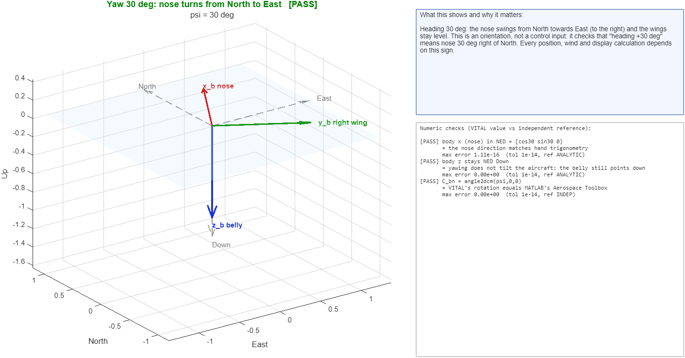

**What this shows and why it matters.** Heading 30 deg: the nose swings from North towards East (to the right) and the wings stay level. This is an orientation, not a control input: it checks that "heading +30 deg" means nose 30 deg right of North. Every position, wind and display calculation depends on this sign.

| result | check | what it means | reference |
|---|---|---|---|
| PASS | body x (nose) in NED = [cos30 sin30 0] | the nose direction matches hand trigonometry | ANALYTIC |
| PASS | body z stays NED Down | yawing does not tilt the aircraft: the belly still points down | ANALYTIC |
| PASS | C_bn = angle2dcm(psi,0,0) | VITAL's rotation equals MATLAB's Aerospace Toolbox | INDEP |

## 2. Pitch 20 deg nose-up: nose rises above the horizon  (`pitch`, PASS)
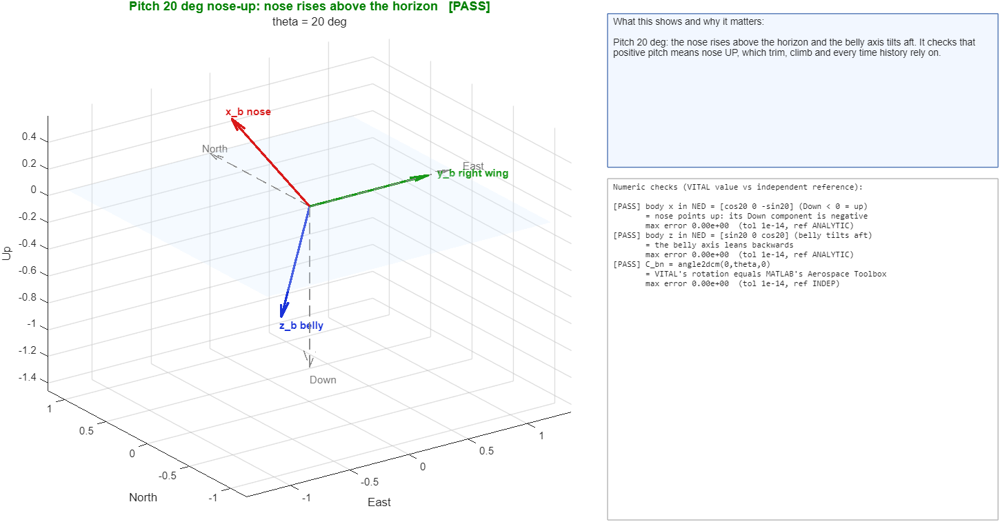

**What this shows and why it matters.** Pitch 20 deg: the nose rises above the horizon and the belly axis tilts aft. It checks that positive pitch means nose UP, which trim, climb and every time history rely on.

| result | check | what it means | reference |
|---|---|---|---|
| PASS | body x in NED = [cos20 0 -sin20] (Down < 0 = up) | nose points up: its Down component is negative | ANALYTIC |
| PASS | body z in NED = [sin20 0 cos20] (belly tilts aft) | the belly axis leans backwards | ANALYTIC |
| PASS | C_bn = angle2dcm(0,theta,0) | VITAL's rotation equals MATLAB's Aerospace Toolbox | INDEP |

## 3. Roll 40 deg: right wing goes down (positive bank)  (`roll`, PASS)
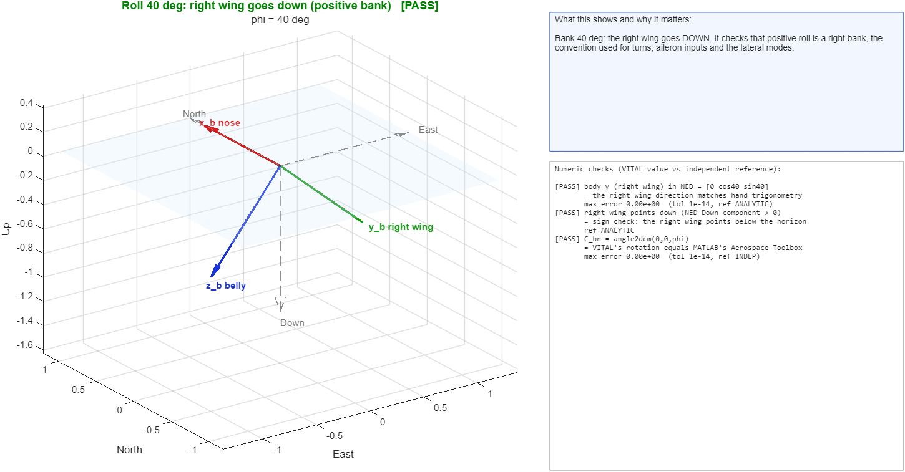

**What this shows and why it matters.** Bank 40 deg: the right wing goes DOWN. It checks that positive roll is a right bank, the convention used for turns, aileron inputs and the lateral modes.

| result | check | what it means | reference |
|---|---|---|---|
| PASS | body y (right wing) in NED = [0 cos40 sin40] | the right wing direction matches hand trigonometry | ANALYTIC |
| PASS | right wing points down (NED Down component > 0) | sign check: the right wing points below the horizon | ANALYTIC |
| PASS | C_bn = angle2dcm(0,0,phi) | VITAL's rotation equals MATLAB's Aerospace Toolbox | INDEP |

## 4. Yaw 30, pitch 20, roll 40 in the 3-2-1 order  (`combined`, PASS)
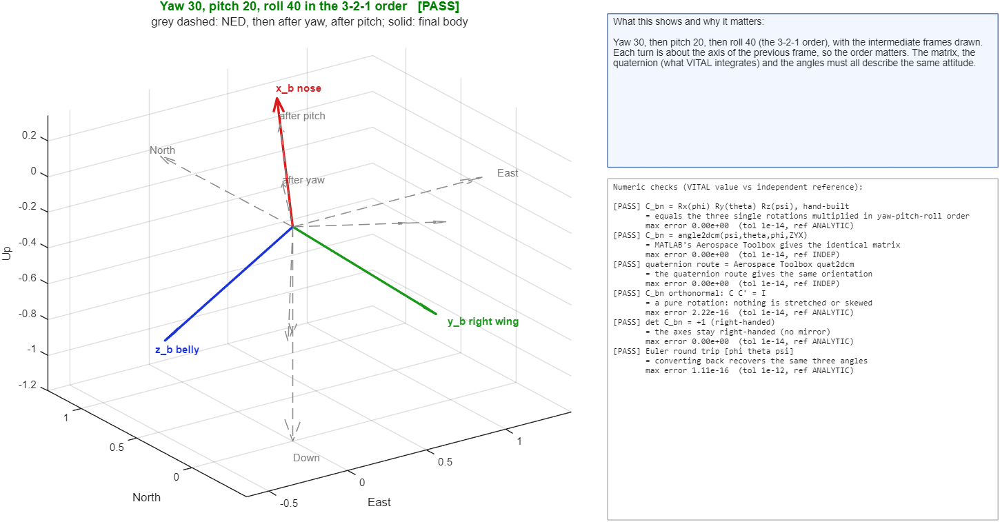

**What this shows and why it matters.** Yaw 30, then pitch 20, then roll 40 (the 3-2-1 order), with the intermediate frames drawn. Each turn is about the axis of the previous frame, so the order matters. The matrix, the quaternion (what VITAL integrates) and the angles must all describe the same attitude.

| result | check | what it means | reference |
|---|---|---|---|
| PASS | C_bn = Rx(phi) Ry(theta) Rz(psi), hand-built | equals the three single rotations multiplied in yaw-pitch-roll order | ANALYTIC |
| PASS | C_bn = angle2dcm(psi,theta,phi,ZYX) | MATLAB's Aerospace Toolbox gives the identical matrix | INDEP |
| PASS | quaternion route = Aerospace Toolbox quat2dcm | the quaternion route gives the same orientation | INDEP |
| PASS | C_bn orthonormal: C C' = I | a pure rotation: nothing is stretched or skewed | ANALYTIC |
| PASS | det C_bn = +1 (right-handed) | the axes stay right-handed (no mirror) | ANALYTIC |
| PASS | Euler round trip [phi theta psi] | converting back recovers the same three angles | ANALYTIC |

## 5. F-16 level trim: velocity is horizontal, alpha = pitch  (`level`, PASS)
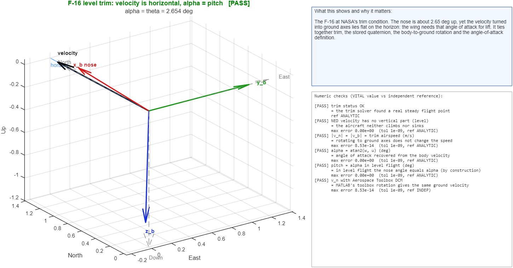

**What this shows and why it matters.** The F-16 at NASA's trim condition. The nose is about 2.65 deg up, yet the velocity turned into ground axes lies flat on the horizon: the wing needs that angle of attack for lift. It ties together trim, the stored quaternion, the body-to-ground rotation and the angle-of-attack definition.

| result | check | what it means | reference |
|---|---|---|---|
| PASS | trim status OK | the trim solver found a real steady flight point | ANALYTIC |
| PASS | NED velocity has no vertical part (level) | the aircraft neither climbs nor sinks | ANALYTIC |
| PASS | /v_n/ = /v_b/ = trim airspeed (m/s) | rotating to ground axes does not change the speed | ANALYTIC |
| PASS | alpha = atan2(w, u) (deg) | angle of attack recovered from the body velocity | ANALYTIC |
| PASS | pitch = alpha in level flight (deg) | in level flight the nose angle equals alpha (by construction) | ANALYTIC |
| PASS | v_n with Aerospace Toolbox DCM | MATLAB's toolbox rotation gives the same ground velocity | INDEP |

## 6. F-16 trim in a 5 deg climb: path climbs at gamma  (`climb`, PASS)
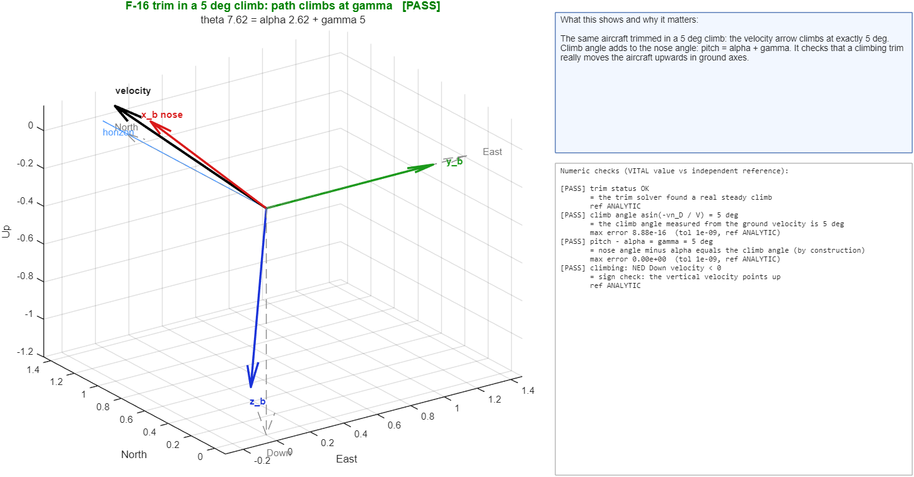

**What this shows and why it matters.** The same aircraft trimmed in a 5 deg climb: the velocity arrow climbs at exactly 5 deg. Climb angle adds to the nose angle: pitch = alpha + gamma. It checks that a climbing trim really moves the aircraft upwards in ground axes.

| result | check | what it means | reference |
|---|---|---|---|
| PASS | trim status OK | the trim solver found a real steady climb | ANALYTIC |
| PASS | climb angle asin(-vn_D / V) = 5 deg | the climb angle measured from the ground velocity is 5 deg | ANALYTIC |
| PASS | pitch - alpha = gamma = 5 deg | nose angle minus alpha equals the climb angle (by construction) | ANALYTIC |
| PASS | climbing: NED Down velocity < 0 | sign check: the vertical velocity points up | ANALYTIC |

## 7. Alpha 5, beta 10 deg; a 10 m/s headwind adds airspeed  (`sideslip`, PASS)
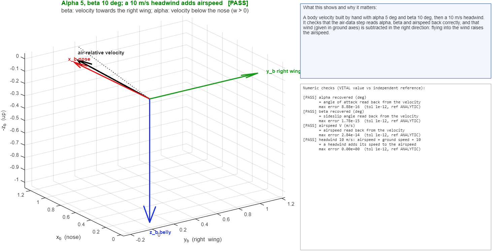

**What this shows and why it matters.** A body velocity built by hand with alpha 5 deg and beta 10 deg, then a 10 m/s headwind. It checks that the air-data step reads alpha, beta and airspeed back correctly, and that wind (given in ground axes) is subtracted in the right direction: flying into the wind raises the airspeed.

| result | check | what it means | reference |
|---|---|---|---|
| PASS | alpha recovered (deg) | angle of attack read back from the velocity | ANALYTIC |
| PASS | beta recovered (deg) | sideslip angle read back from the velocity | ANALYTIC |
| PASS | airspeed V (m/s) | airspeed read back from the velocity | ANALYTIC |
| PASS | headwind 10 m/s: airspeed = ground speed + 10 | a headwind adds its speed to the airspeed | ANALYTIC |

## 8. Gravity (always NED Down) seen in body axes  (`gravity`, PASS)
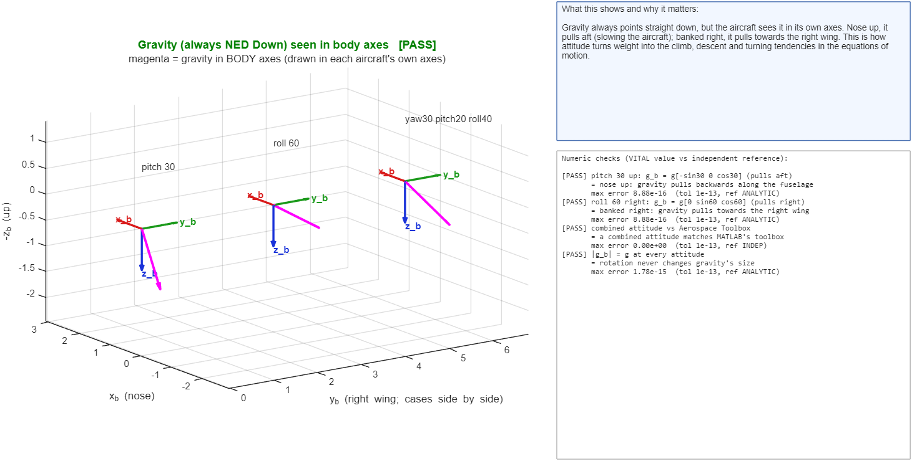

**What this shows and why it matters.** Gravity always points straight down, but the aircraft sees it in its own axes. Nose up, it pulls aft (slowing the aircraft); banked right, it pulls towards the right wing. This is how attitude turns weight into the climb, descent and turning tendencies in the equations of motion.

| result | check | what it means | reference |
|---|---|---|---|
| PASS | pitch 30 up: g_b = g[-sin30 0 cos30] (pulls aft) | nose up: gravity pulls backwards along the fuselage | ANALYTIC |
| PASS | roll 60 right: g_b = g[0 sin60 cos60] (pulls right) | banked right: gravity pulls towards the right wing | ANALYTIC |
| PASS | combined attitude vs Aerospace Toolbox | a combined attitude matches MATLAB's toolbox | INDEP |
| PASS | /g_b/ = g at every attitude | rotation never changes gravity's size | ANALYTIC |

## 9. CG and reference points (BFRP), side view  (`cg`, PASS)
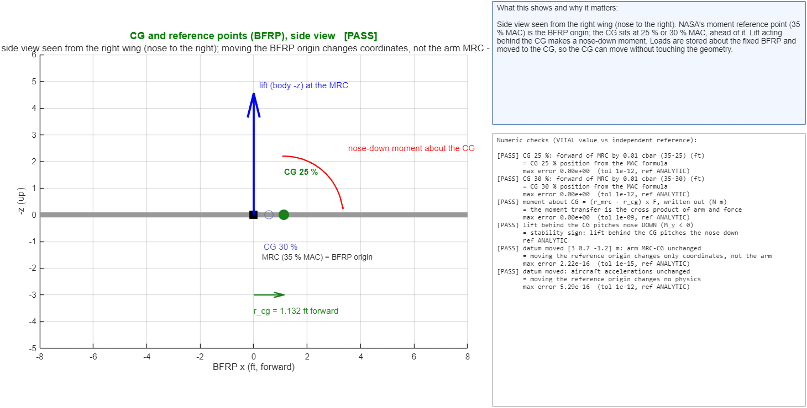

**What this shows and why it matters.** Side view seen from the right wing (nose to the right). NASA's moment reference point (35 % MAC) is the BFRP origin; the CG sits at 25 % or 30 % MAC, ahead of it. Lift acting behind the CG makes a nose-down moment. Loads are stored about the fixed BFRP and moved to the CG, so the CG can move without touching the geometry.

| result | check | what it means | reference |
|---|---|---|---|
| PASS | CG 25 %: forward of MRC by 0.01 cbar (35-25) (ft) | CG 25 % position from the MAC formula | ANALYTIC |
| PASS | CG 30 %: forward of MRC by 0.01 cbar (35-30) (ft) | CG 30 % position from the MAC formula | ANALYTIC |
| PASS | moment about CG = (r_mrc - r_cg) x F, written out (N m) | the moment transfer is the cross product of arm and force | ANALYTIC |
| PASS | lift behind the CG pitches nose DOWN (M_y < 0) | stability sign: lift behind the CG pitches the nose down | ANALYTIC |
| PASS | datum moved [3 0.7 -1.2] m: arm MRC-CG unchanged | moving the reference origin changes only coordinates, not the arm | ANALYTIC |
| PASS | datum moved: aircraft accelerations unchanged | moving the reference origin changes no physics | ANALYTIC |

## 10. NASA station coordinates (x aft, z up) into body axes (x forward, z down)  (`station`, PASS)
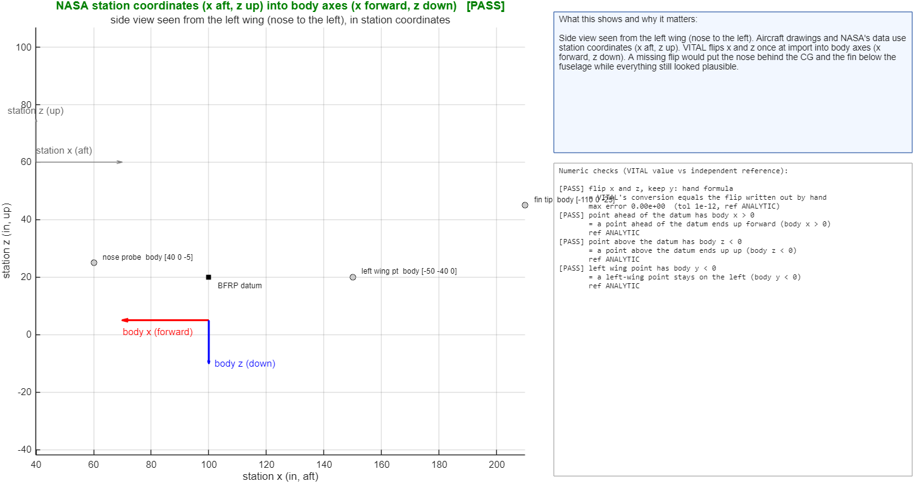

**What this shows and why it matters.** Side view seen from the left wing (nose to the left). Aircraft drawings and NASA's data use station coordinates (x aft, z up). VITAL flips x and z once at import into body axes (x forward, z down). A missing flip would put the nose behind the CG and the fin below the fuselage while everything still looked plausible.

| result | check | what it means | reference |
|---|---|---|---|
| PASS | flip x and z, keep y: hand formula | VITAL's conversion equals the flip written out by hand | ANALYTIC |
| PASS | point ahead of the datum has body x > 0 | a point ahead of the datum ends up forward (body x > 0) | ANALYTIC |
| PASS | point above the datum has body z < 0 | a point above the datum ends up up (body z < 0) | ANALYTIC |
| PASS | left wing point has body y < 0 | a left-wing point stays on the left (body y < 0) | ANALYTIC |

## 11. Control moments at trim: +1 deg gives a negative moment about its own axis  (`control`, PASS)
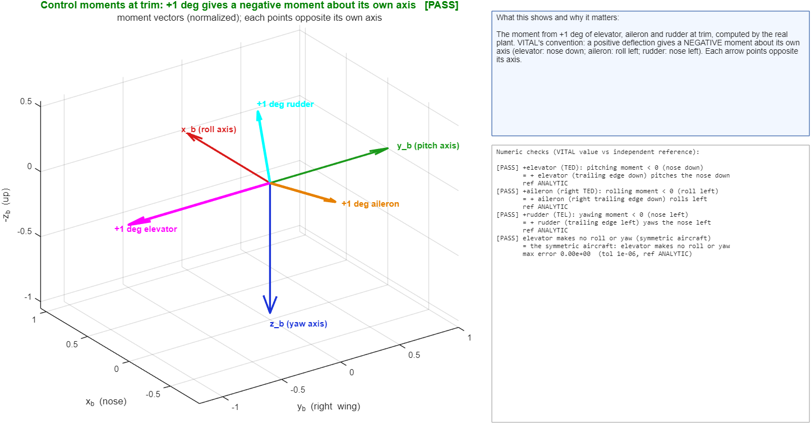

**What this shows and why it matters.** The moment from +1 deg of elevator, aileron and rudder at trim, computed by the real plant. VITAL's convention: a positive deflection gives a NEGATIVE moment about its own axis (elevator: nose down; aileron: roll left; rudder: nose left). Each arrow points opposite its axis.

| result | check | what it means | reference |
|---|---|---|---|
| PASS | +elevator (TED): pitching moment < 0 (nose down) | + elevator (trailing edge down) pitches the nose down | ANALYTIC |
| PASS | +aileron (right TED): rolling moment < 0 (roll left) | + aileron (right trailing edge down) rolls left | ANALYTIC |
| PASS | +rudder (TEL): yawing moment < 0 (nose left) | + rudder (trailing edge left) yaws the nose left | ANALYTIC |
| PASS | elevator makes no roll or yaw (symmetric aircraft) | the symmetric aircraft: elevator makes no roll or yaw | ANALYTIC |

## 12. Simulated 2 deg aileron step: path and body axes along it  (`path`, PASS)
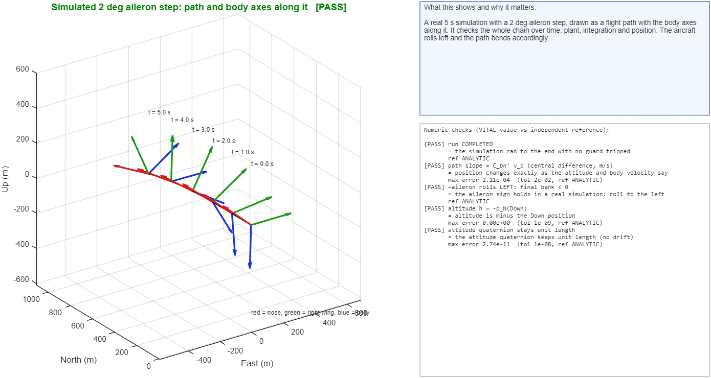

**What this shows and why it matters.** A real 5 s simulation with a 2 deg aileron step, drawn as a flight path with the body axes along it. It checks the whole chain over time: plant, integration and position. The aircraft rolls left and the path bends accordingly.

| result | check | what it means | reference |
|---|---|---|---|
| PASS | run COMPLETED | the simulation ran to the end with no guard tripped | ANALYTIC |
| PASS | path slope = C_bn' v_b (central difference, m/s) | position changes exactly as the attitude and body velocity say | ANALYTIC |
| PASS | +aileron rolls LEFT: final bank < 0 | the aileron sign holds in a real simulation: roll to the left | ANALYTIC |
| PASS | altitude h = -p_N(Down) | altitude is minus the Down position | ANALYTIC |
| PASS | attitude quaternion stays unit length | the attitude quaternion keeps unit length (no drift) | ANALYTIC |

## 13. Local NED on the WGS-84 Earth at 36 N, 75 W  (`earth`, PASS)
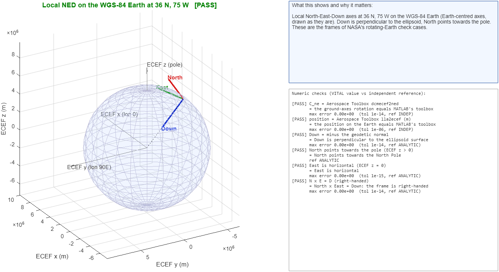

**What this shows and why it matters.** Local North-East-Down axes at 36 N, 75 W on the WGS-84 Earth (Earth-centred axes, drawn as they are). Down is perpendicular to the ellipsoid, North points towards the pole. These are the frames of NASA's rotating-Earth check cases.

| result | check | what it means | reference |
|---|---|---|---|
| PASS | C_ne = Aerospace Toolbox dcmecef2ned | the ground-axes rotation equals MATLAB's toolbox | INDEP |
| PASS | position = Aerospace Toolbox lla2ecef (m) | the position on the Earth equals MATLAB's toolbox | INDEP |
| PASS | Down = minus the geodetic normal | Down is perpendicular to the ellipsoid surface | ANALYTIC |
| PASS | North points towards the pole (ECEF z > 0) | North points towards the North Pole | ANALYTIC |
| PASS | East is horizontal (ECEF z = 0) | East is horizontal | ANALYTIC |
| PASS | N x E = D (right-handed) | North x East = Down: the frame is right-handed | ANALYTIC |

Cases: yaw, pitch, roll, combined, level, climb, sideslip, gravity, cg, station, control, path, earth.
